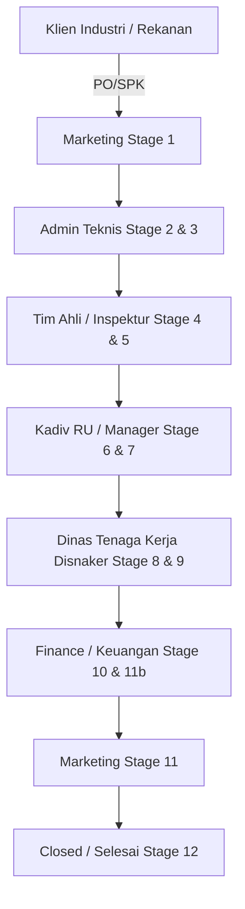
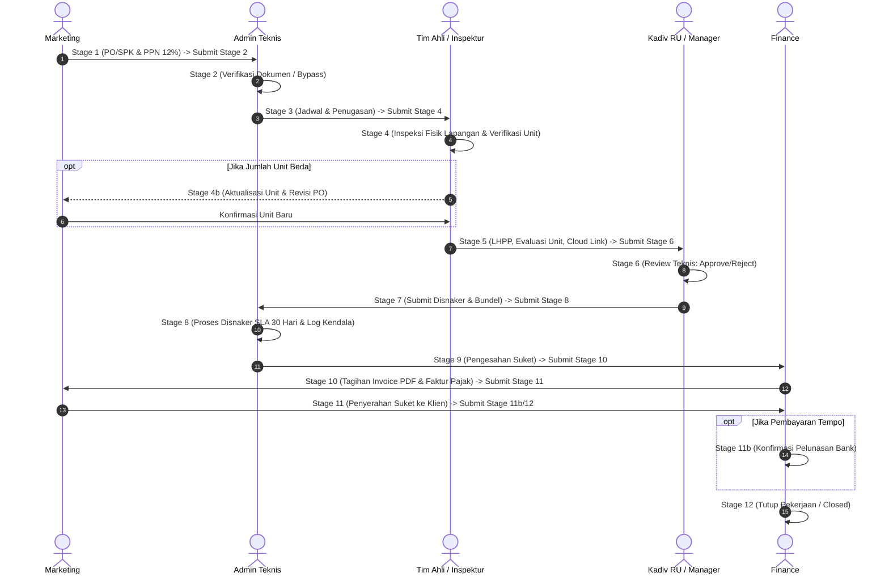

# PANDUAN PENGGUNA LENGKAP & SPESIFIKASI TEKNIS SISTEM
# DNP MONITOR (RIKSA UJI MANAGEMENT SYSTEM)
> **PT Delta Nusantara Persada (PJK3 Bidang Pemeriksaan dan Pengujian K3)**  
> **Versi Dokumen:** 2.4-Production | **Basis Rilis:** Laravel 11 · React 18 · Inertia.js · Tailwind CSS  
> **Tanggal Pembaruan:** November 2026 | **Klasifikasi:** Dokumen Operasional & Manual Pengguna Resmi

---

## DAFTAR ISI

1. [BAGIAN 1: Gambaran Sistem, Arsitektur & Teknologi](#bagian-1-gambaran-sistem-arsitektur--teknologi)
   - 1.1 Profil Aplikasi DNP Monitor
   - 1.2 Arsitektur Sistem & Stack Teknologi
   - 1.3 Siklus Hidup Pekerjaan (14-Stage Lifecycle & Conditional Branches)
2. [BAGIAN 2: Matriks Peran, Wewenang & Hak Akses (Role Permission Matrix)](#bagian-2-matriks-peran-wewenang--hak-akses-role-permission-matrix)
   - 2.1 Enam Role Utama Sistem
   - 2.2 Hak Akses Finansial & Visibilitas Nilai Kontrak (`canSeeNilai`)
   - 2.3 Matriks Izin Tahapan Dinamis (`user_stage_permissions`)
   - 2.4 Persistensi Akses Tim Ahli / Inspektur
3. [BAGIAN 3: Navigasi Antarmuka & Halaman Utama](#bagian-3-navigasi-antarmuka--halaman-utama)
   - 3.1 Login, Sesi & Keamanan Akun
   - 3.2 Tata Letak Antarmuka (Desktop Sidebar & Responsive Mobile Layout)
   - 3.3 Dashboard KPI Terpusat (`/`)
   - 3.4 Papan Visual Kanban (`/kanban`)
   - 3.5 Daftar Tabular Pekerjaan (`/jobs`)
   - 3.6 Modul Peringatan Suket & SKP (`/reminder-suket`)
   - 3.7 Modul Inventaris & Master Data (`/inventory`)
   - 3.8 Modul Analitik & Pelaporan (`/pelaporan`)
   - 3.9 Manajemen Pengguna & Otoritas (`/users`)
   - 3.10 Pengaturan Profil & Sandi Mandiri (`/profile`)
4. [BAGIAN 4: Panduan Operasional Terperinci Tahap demi Tahap (Stage 1 – 14)](#bagian-4-panduan-operasional-terperinci-tahap-demi-tahap-stage-1--14)
   - 4.1 Stage 1 (PO / SPK) – Inisiasi Order & Kalkulator PPN 12%
   - 4.2 Stage 2 (Verifikasi Dokumen) – Pemeriksaan Dokumen & Sertifikat Bahan
   - 4.3 Stage 3 (Penjadwalan & Surat Tugas) – Rekomendasi Pintar Ahli & Alat Uji
   - 4.4 Stage 4 (Pelaksanaan RU) – Inspeksi Lapangan & Verifikasi Unit Aktual
   - 4.5 Stage 4b (Aktualisasi Unit) – Penyesuaian Kontrak Akibat Mismatch Lapangan
   - 4.6 Stage 5 (Penyusunan LHPP) – Evaluasi Multi-Unit, Cloud Link & Bypass
   - 4.7 Stage 6 (Review Laporan Teknis) – Persetujuan Manager & Siklus Revisi
   - 4.8 Stage 7 (Submit Disnaker) – Pemberkasan Fisik & Pemicu SLA 30 Hari
   - 4.9 Stage 8 (Proses Disnaker) – SLA EWS, Log Follow-Up & Tagging Kendala
   - 4.10 Stage 9 (Pengurusan Suket) – Pencatatan Nomor Suket & Peringatan H-90
   - 4.11 Stage 10 (Penagihan) – Enforced PDF Invoice, Faktur Pajak & Peringatan Tgl 15
   - 4.12 Stage 11 (Penyerahan Suket ke Klien) – Handover Fisik & Tanda Terima
   - 4.13 Stage 11b (Pembayaran / Pelunasan) – Konfirmasi Pembayaran Tempo/Kredit
   - 4.14 Stage 12 / 14 (Selesai & Closed) – Penutupan Job & Pembukaan Kembali
5. [BAGIAN 5: Pengelolaan Master Data Inventaris & Dokumen](#bagian-5-pengelolaan-master-data-inventaris--dokumen)
   - 5.1 Inventaris Alat Uji (23 Tool Items) & Monitoring Kalibrasi
   - 5.2 Sertifikat PJK3 & SK Kemnaker
   - 5.3 Profil Tim Ahli / Inspektur & Masa Berlaku SKP
   - 5.4 Regulasi K3 & Master Standar
   - 5.5 Katalog Form Disnaker & Pengurutan Alami (Natural Sorting)
   - 5.6 Template Dokumen Master (.docx) & Spesifikasi Tag Placeholder
6. [BAGIAN 6: Fitur Audit Trail, Keamanan & Log Deduping](#bagian-6-fitur-audit-trail-keamanan--log-deduping)
   - 6.1 Riwayat Aktivitas & Coalescing Helper (Deduplikasi Log)
   - 6.2 Preservasi Nama Asli Dokumen (`sanitizeAndDeduplicateFilename`)
   - 6.3 Perlindungan Sistem Bot & Scraper (`BlockAiAndScraperBots`)
7. [BAGIAN 7: Penanganan Kasus Khusus, Resolusi Konflik & FAQ](#bagian-7-penanganan-kasus-khusus-resolusi-konflik--faq)
   - 7.1 Matriks Resolusi Konflik & Keputusan Review (Item Review 1–20)
   - 7.2 Tanya Jawab Populer (FAQ)
   - 7.3 Prosedur Eskalasi Darurat

---

# BAGIAN 1: GAMBARAN SISTEM, ARSITEKTUR & TEKNOLOGI

## 1.1 Profil Aplikasi DNP Monitor
DNP Monitor adalah platform Enterprise Resource Planning (ERP) khusus alur kerja Pemeriksaan dan Pengujian (Riksa Uji) K3 yang dioperasikan oleh **PT Delta Nusantara Persada**. Sistem ini mengatur, memantau, dan mengarsipkan seluruh siklus hidup riksa uji teknis—mulai dari penerimaan Purchase Order (PO/SPK) dari klien industri, verifikasi berkas permohonan, penjadwalan inspektur bersertifikasi SKP Kemnaker, inspeksi fisik alat di lapangan, penyusunan Laporan Hasil Pemeriksaan dan Pengujian (LHPP), proses pengesahan ke Dinas Tenaga Kerja (Disnaker), penerbitan Surat Keterangan (Suket), penagihan keuangan (invoicing), hingga pelunasan dan penutupan pekerjaan.

## 1.2 Arsitektur Sistem & Stack Teknologi
Aplikasi dibangun menggunakan arsitektur modern monolitik terpisah (hybrid SPA) dengan stack:
- **Backend:** PHP 8.2+ / Laravel 11 Framework dengan arsitektur MVC, Eloquent ORM, Gate/Policy Authorization, serta Service Container.
- **Frontend:** React 18 dengan Inertia.js (menghilangkan kebutuhan REST API overhead dan menyajikan rendering state reaktif dari controller Laravel secara aman).
- **Styling & Komponen:** Tailwind CSS 3.4+, Lucide React Icons untuk ikonografi antarmuka, SweetAlert2 untuk dialog konfirmasi interaktif.
- **Basis Data:** SQLite (Development / Standalone Testing) dan MySQL/MariaDB (Production Server).
- **Engine Dokumen:** PHPWord / DocxTemplater untuk generasi otomatis Surat Tugas dan Formulir Lapangan terisi placeholder data dinamis, serta integrasi headless browser engine untuk render PDF.

## 1.3 Siklus Hidup Pekerjaan (14-Stage Lifecycle & Conditional Branches)
Sistem DNP Monitor mengimplementasikan alur kendali ketat 14 stage:

| No | Kode Tampilan | Nama Tahapan Resmi | Divisi Penanggung Jawab (PIC) | SLA Target | Status Wajib / Kondisional |
|:---:|:---:|---|:---:|:---:|:---:|
| 1 | `1` | **PO / SPK** | Marketing (`MKT`) | — | Wajib (Gerbang Awal) |
| 2 | `2` | **Verifikasi Dokumen** | Admin Teknis (`ADM`) | 1 Hari | Wajib (Ada Bypass Manager) |
| 3 | `3` | **Penjadwalan & Surat Tugas** | Admin Teknis (`ADM`) | 1 Hari | Wajib |
| 4 | `4` | **Pelaksanaan RU** | Tim Ahli / Inspektur (`INS`) | Sesuai Jadwal | Wajib |
| 5 | `4b` | **Aktualisasi Unit** *(ID: 13)* | Marketing (`MKT`) | 1 Hari | Kondisional (Bila Unit Beda) |
| 6 | `5` | **Penyusunan LHPP** | Tim Ahli / Inspektur (`INS`) | 3 Hari | Wajib |
| 7 | `6` | **Review Laporan Teknis** | Kadiv RU / Manager (`MGR`) | 1 Hari × Unit | Wajib (Approval / Rejeki) |
| 8 | `7` | **Submit Disnaker** | Kadiv RU / Manager (`MGR`) | 1 Hari | Wajib (Pemicu Argo SLA) |
| 9 | `8` | **Proses Disnaker** | Admin Teknis (`ADM`) | 30 Hari | Wajib (EWS Monitoring) |
| 10 | `9` | **Pengurusan Suket** | Admin Teknis (`ADM`) | 1 Hari | Wajib |
| 11 | `10` | **Penagihan (Invoicing)** | Finance (`FIN`) | 1 Hari | Wajib |
| 12 | `11` | **Penyerahan Suket** | Marketing (`MKT`) | 2 Hari | Wajib |
| 13 | `11b` | **Pembayaran / Pelunasan** *(ID: 14)* | Finance (`FIN`) | Sesuai TOP | Kondisional (Jika Kredit) |
| 14 | `12` | **Selesai / Closed** | Sistem / Finance / Superadmin | Permanen | Wajib (Arsip Tertutup) |

---

# BAGIAN 2: MATRIKS PERAN, WEWENANG & HAK AKSES (ROLE PERMISSION MATRIX)

## 2.1 Enam Role Utama Sistem
Setiap pengguna yang terdaftar di DNP Monitor memiliki satu role utama yang membatasi hak akses halaman dan aksi:
1. **Marketing (`MKT`):** Bertanggung jawab atas inisiasi pekerjaan baru di Stage 1, revisi nilai kontrak/PO di Stage 4b jika ada deviasi unit aktual, serta penyerahan fisik Suket resmi ke perwakilan klien di Stage 11.
2. **Admin Dokumen & RU (`ADM`):** Memverifikasi kelengkapan berkas legalitas di Stage 2, menyusun jadwal inspeksi dan penugasan alat di Stage 3, memantau SLA 30 hari proses dinas di Stage 8, serta mencatatkan nomor Suket di Stage 9.
3. **Tim Ahli / Inspektur (`INS`):** Menjalankan pemeriksaan teknis visual dan fungsional di lokasi proyek di Stage 4, mengunggah BAP, serta mengisi evaluasi teknis, rekomendasi per unit, dan link berkas LHPP di Stage 5.
4. **Kadiv RU / Manager (`MGR`):** Memvalidasi laporan hasil uji di Stage 6 (berhak Approve, Approve Bersyarat, atau Reject kembali ke Stage 5), memberikan persetujuan bypass dokumen Stage 2, dan memvalidasi penyerahan bundel ke Disnaker di Stage 7.
5. **Admin Keuangan / Finance (`FIN`):** Menerbitkan tagihan invoice resmi di Stage 10, mengunggah Faktur Pajak, memantau Terms of Payment (TOP), memverifikasi bukti pelunasan di Stage 11b, dan menutup pekerjaan di Stage 12.
6. **Super Administrator (`SUP`):** Memiliki hak override penuh lintas seluruh tahapan, manajemen akun pengguna, pengaturan matriks izin dinamis, pembukaan kembali pekerjaan yang sudah ditutup (`reopenJob`), serta kontrol penuh master inventaris.

## 2.2 Hak Akses Finansial & Visibilitas Nilai Kontrak (`canSeeNilai`)
Sesuai hasil audit teknis:
- **Role yang BERHAK melihat nilai kontrak (`canSeeNilai = true`):** Superadmin, Finance, Marketing, dan Kadiv RU / Manager.
- **Role yang DIBATASI (`canSeeNilai = false`):** Tim Ahli / Inspektur Lapangan (`INS`). Nilai rupiah kontrak, tagihan, dan rincian nominal dienkapsulasi dan disembunyikan dari tampilan kartu Kanban, detail modal, maupun daftar job demi menjaga kerahasiaan komersial perusahaan.

## 2.3 Matriks Izin Tahapan Dinamis (`user_stage_permissions`)
Di samping role dasar, Superadmin dapat mengonfigurasi tabel `user_stage_permissions` secara spesifik per individu. Izin ini menentukan:
- Tahapan mana saja yang tombol aksinya dapat diklik oleh pengguna tersebut.
- Pengguna dengan izin khusus dapat membantu proses lintas departemen tanpa harus mengubah role intinya (misalnya: Admin senior yang diberikan hak review Stage 6 saat Manager bertugas di luar kantor).

## 2.4 Persistensi Akses Tim Ahli / Inspektur
Fitur filter visibilitas pekerjaan (`visibleJobs`) di backend dan frontend menjamin bahwa Inspektur yang pernah ditugaskan pada suatu pekerjaan akan **tetap memiliki akses melihat pekerjaan tersebut di dasbornya**, bahkan jika pekerjaan tersebut mengalami penolakan (reject) atau ditarik mundur kembali ke Stage 3 atau Stage 1. Hal ini mencegah hilangnya jejak penugasan inspektur saat revisi administratif berlangsung.

---

# BAGIAN 3: NAVIGASI ANTARMUKA & HALAMAN UTAMA

## 3.1 Login, Sesi & Keamanan Akun
- Pengguna mengakses halaman login melalui rute bawaan otentikasi.
- Form login memvalidasi email terdaftar dan kata sandi terenkripsi Bcrypt.
- Sesi dilindungi proteksi CSRF token di setiap request Inertia.
- Tersedia fitur logout instan di bilah navigasi profil atas.

## 3.2 Tata Letak Antarmuka (Desktop Sidebar & Responsive Mobile Layout)
- **Desktop (Layar Besar):** Bilah samping (Sidebar) kiri dengan tema Navy Eksklusif (`#062444`), memuat tautan menu dengan status aktif yang terang.
- **Mobile / Tablet (Layar Sentuh):** Sidebar dapat dilipat otomatis menjadi toggle hamburger di pojok kiri atas. Seluruh elemen tabel dan kartu modal dirancang touch-friendly sehingga inspektur lapangan dapat mengisi data langsung dari smartphone di area pabrik.

## 3.3 Dashboard KPI Terpusat (`/`)
Halaman dasbor menyajikan visualisasi analitik eksekutif:
- **Kartu Ringkasan KPI:** Menampilkan Total Job Aktif, Job Selesai Bulan Ini, Job Mendekati SLA Disnaker, dan Total Piutang Belum Tertagih.
- **Grafik Distribusi Stage:** Grafik batang/lingkaran interaktif yang mengelompokkan persebaran pekerjaan di 14 stage.
- **Pekerjaan Saya vs Semua Job:** Tombol alih cepat untuk memfilter pekerjaan yang menjadi tanggung jawab langsung akun yang sedang login vs pekerjaan divisi secara menyeluruh.

## 3.4 Papan Visual Kanban (`/kanban`)
Halaman Kanban Board adalah pusat komando operasional DNP Monitor:
- **Tampilan Gelombang (Wave Background):** Dilengkapi aksen estetika grafis gelombang cyan-kebiruan (`#00A8E8`) yang elegan dan modern.
- **14 Kolom Tahapan:** Menampilkan kartu pekerjaan dengan informasi nama klien, bidang riksa uji, jumlah unit, dan lencana status.
- **Peringatan Kendala (`s8_delay_reason`):** Kartu yang mengalami hambatan pada proses dinas di Stage 8 menampilkan badge status merah/kuning beserta teks alasan kendala langsung di kartu Kanban tanpa harus membuka modal detail.
- **Interaksi Satu-Klik:** Mengklik kartu akan membuka panel geser terpadu **Job Detail Sheet** dari sisi kanan layar.

## 3.5 Daftar Tabular Pekerjaan (`/jobs`)
Halaman daftar job menyajikan tampilan tabular komprehensif bagi staf yang menyukai pencarian data massal:
- **Kolom Tabel:** Nomor Urut, Kode Job, Nama Klien, Bidang Pesawat K3, Jumlah Unit, PIC Lapangan, Posisi Stage Terkini, Status Pembayaran, dan Tombol Tindakan.
- **Fitur Penyaringan (Filter):** Filter berdasarkan Kategori Pesawat (PUBT, PAA, Elevator, Kelistrikan, Proteksi Kebakaran), Filter Stage Aktif, serta Filter Inspektur.
- **Pencarian Cepat:** Input instan untuk menemukan pekerjaan berdasarkan nama PT Klien atau nomor kontrak.

## 3.6 Modul Reminder Suket & SKP (`/reminder-suket`)
Modul ini bertindak sebagai **Early Warning System (EWS)** masa berlaku dokumen legalitas:
- **Monitoring Kadaluarsa Suket Klien (H-90):** Mendeteksi seluruh Surat Keterangan K3 yang diterbitkan dan memberikan tanda peringatan sejak 90 hari sebelum masa berlaku 1 tahun / 2 tahun berakhir. Marketing dapat memanfaatkan data ini untuk inisiasi penawaran resertifikasi ulang.
- **Monitoring SKP Ahli K3 (H-60):** Memantau masa aktif penunjukan Surat Keputusan Ahli K3 internal DNP dari Kementerian Ketenagakerjaan.
- **Monitoring Kalibrasi Alat Uji (H-30):** Menyorot instrumen alat uji yang sertifikat kalibrasinya akan habis dalam kurun waktu 30 hari.

## 3.7 Modul Inventaris & Master Data (`/inventory`)
Pusat pengelolaan aset teknis perusahaan yang terbagi ke dalam 5 sub-tab:
1. **Inventaris Alat Uji:** 23 item instrumen uji lapangan.
2. **Profil Tim Ahli / Inspektur:** Data SKP Kemnaker dan spesialisasi bidang.
3. **Sertifikat PJK3:** Legalitas izin operasional PT Delta Nusantara Persada.
4. **Regulasi K3:** Referensi dasar hukum Permenaker dan Undang-Undang.
5. **Template Dokumen Master & Katalog Form Disnaker:** Format baku formulir pemeriksaan dinas.

## 3.8 Modul Analitik & Pelaporan (`/pelaporan`)
Modul rekapitulasi data operasional:
- Pemilihan rentang tanggal pekerjaan (Tanggal Mulai hingga Tanggal Selesai).
- Filter status pekerjaan (Aktif, Tertunda, Closed).
- Tombol **Export Excel / Spreadsheet (`/pelaporan/export`)** untuk kebutuhan audit kepatuhan, pelaporan berkala ke direksi, atau arsip internal dinas.

## 3.9 Manajemen Pengguna & Otoritas (User Management - `/users`)
Khusus diakses oleh role Superadmin:
- Pembuatan akun baru dengan penetapan role awal.
- Penonaktifan atau penghapusan pengguna (`destroy`).
- Pengisian dan pembaruan nomor telepon WhatsApp resmi pengguna untuk integrasi notifikasi (`updatePhone`).
- Pengaturan matriks izin pengerjaan stage secara individual (`updatePermissions`).

## 3.10 Pengaturan Profil & Sandi Mandiri (`/profile`)
Setiap staf dapat mengelola akun pribadinya:
- Memperbarui Nama Tampilan dan Alamat Email resmi.
- Melakukan pergantian Kata Sandi secara mandiri dengan verifikasi kata sandi lama demi menjaga keamanan sistem.

---

# BAGIAN 4: PANDUAN OPERASIONAL TERPERINCI TAHAP DEMI TAHAP (STAGE 1 – 14)

---

## 4.1 Stage 1 (PO / SPK) – Inisiasi Order & Kalkulator PPN 12%
Tahapan gerbang awal pekerjaan di DNP Monitor. Hanya Marketing atau Superadmin yang berwenang membuat pekerjaan baru melalui tombol `+ Job Baru` atau rute `/jobs/create`.

### Prosedur Input Form Stage 1:
1. **Identitas Klien:** Masukkan Nama Perusahaan Klien, Alamat Pabrik/Gedung, Nama PIC Lapangan, dan Nomor Kontak PIC.
2. **Lokasi Proyek:** Pilih Kota/Kabupaten melalui kotak dropdown otomatis yang memuat seluruh 514 Kota/Kabupaten resmi di Indonesia.
3. **Spesifikasi Teknis:** Tentukan Bidang Pemeriksaan (misal: Pesawat Uap & Bejana Tekan, Pesawat Angkat & Angkut, Instalasi Listrik), Tipe Alat, dan Jumlah Unit Kontrak.
4. **Kalkulator Interaktif PPN 12%:**
   - Masukkan nominal **Dasar Pengenaan Pajak (DPP)** di kolom Nilai Kontrak.
   - Kotak kalkulasi interaktif otomatis menghitung secara real-time:
     - **DPP:** Nominal sebelum pajak (disimpan murni di database).
     - **PPN 12%:** Nilai pertambahan nilai resmi tarif 12%.
     - **Total Tagihan:** DPP + PPN 12%.
5. **Jadwal Pelaksanaan Multi-Hari:** Tentukan estimasi tanggal pelaksanaan inspeksi menggunakan Multi-Day Schedule Builder.
6. **Slot Dedicated Dokumen Tambahan & Gerbang Dokumen Wajib:**
   - Tersedia slot terdedikasi untuk *Dokumen Tambahan* (seperti Surat Permohonan Klien, Surat Kuasa, atau Gambar Denah Lokasi).
   - **Gerbang Keamanan Validasi:** Sistem memberlakukan validasi ketat di mana minimal satu dari dokumen legalitas awal (Scan File PO/SPK, Surat Permohonan Klien, atau Surat Kuasa Resmi) **wajib diunggah** sebelum tombol `Lanjutkan ke Stage 2` dapat diaktifkan.

---

## 4.2 Stage 2 (Verifikasi Dokumen) – Pemeriksaan Dokumen & Sertifikat Bahan
Admin Teknis bertanggung jawab memeriksa keabsahan dan kelengkapan berkas administrasi klien sebelum tim diterjunkan.

### Prosedur Kerja Stage 2:
1. Buka Job Detail Sheet pada Stage 2.
2. Periksa dokumen yang telah diunggah Marketing.
3. Berikan status pada checklist digital: klik **OK**, **Tidak**, atau **NA** (Not Applicable) untuk setiap butir persyaratan.
4. **Slot Khusus Sertifikat Bahan (PAA / Lift):** Untuk bidang Pesawat Angkat Angkut (PAA), Elevator, dan Eskalator, sistem menampilkan slot kondisional wajib untuk mengunggah *Mill Certificate / Sertifikat Uji Bahan Tali Kawat Baja (Sling) / Rantai*.
5. **Mekanisme Request Bypass Manager:** Jika berkas fisik klien masih dalam proses legalisasi namun jadwal pemeriksaan di lapangan sudah sangat mendesak, Admin dapat mengklik tombol **`Request Bypass Manager`**. Permohonan ini akan mengirimkan notifikasi izin ke Kadiv RU untuk memperbolehkan pekerjaan melaju ke Stage 3 dengan catatan garansi dokumen menyusul.

---

## 4.3 Stage 3 (Penjadwalan & Surat Tugas) – Rekomendasi Pintar Ahli & Alat Uji
Pada tahap ini, Admin Teknis mengunci jadwal riksa uji resmi, menugaskan personel ahli bersertifikat, dan mengalokasikan instrumen uji.

### Fitur Utama Stage 3:
1. **Smart Recommendation Tim Ahli (Inspector Recommendation Engine):**
   - Sistem mencocokkan bidang pekerjaan (misal: Listrik / PAA) dengan basis data inventaris profil inspektur.
   - Sistem merekomendasikan nama inspektur yang memiliki **SKP Kemnaker Aktif** pada bidang tersebut dan bebas dari jadwal bentrok di tanggal yang sama.
2. **Alokasi Alat Uji Lapangan:** Memilih instrumen uji dari 23 master alat (misal: Earth Tester, Tachometer, Sound Level Meter, Thickness Gauge) yang berstatus kalibrasi valid.
3. **Pemberitahuan H-5 Disnaker:** Menandai tanggal pengiriman Surat Pemberitahuan Pelaksanaan Pemeriksaan ke kantor dinas ketenagakerjaan setempat (wajib dilakukan minimal 5 hari sebelum hari pelaksanaan).
4. **Generator Otomatis Dokumen Lapangan (.docx):**
   - Klik tombol **`Download Surat Tugas`** untuk menghasilkan berkas resmi penugasan format Word yang telah terisi data nomor surat, nama tim ahli, nama klien, dan lokasi.
   - Klik tombol **`Download Form Riksa Uji`** untuk mencetak formulir checklist pemeriksaan lapangan yang siap diisi secara fisik oleh inspektur.

---

## 4.4 Stage 4 (Pelaksanaan RU) – Inspeksi Lapangan & Verifikasi Unit Aktual
Tim Ahli / Inspektur Lapangan menjalankan pengujian fisik di area operasional pabrik atau gedung klien.

### Prosedur Lapangan:
1. **Verifikasi Jumlah Unit Aktual:**
   - Inspektur menghitung jumlah fisik mesin/pesawat yang benar-benar siap dan layak diuji di lokasi.
   - Masukkan angka tersebut ke input `Jumlah Unit Aktual`.
   - **Kondisi Khusus (Mismatch Unit):** Jika jumlah unit di lapangan tidak sama dengan jumlah pada kontrak awal (misalnya kontrak 5 unit, namun di lokasi hanya ada 3 unit mesin yang menyala), sistem memunculkan peringatan kuning dan mengaktifkan tombol **`Kembalikan ke Stage 1 / Alihkan ke Stage 4b`**. Pekerjaan tidak boleh diteruskan ke pembuatan laporan teknis sebelum klausul komersial diselesaikan oleh Marketing.
2. **Checklist Digital Pemeriksaan:** Mengisi pemeriksaan komponen nameplate pabrikan, konstruksi visual, alat perlindungan diri, dan uji fungsi pengaman darurat (safety device test).
3. **Dokumentasi Visual Lapangan:** Mengunggah foto dokumentasi pengujian unit menggunakan fitur kamera smartphone langsung ke sistem.
4. **Unggah Berita Acara Pemeriksaan (BAP):** Mengunggah scan dokumen BAP asli yang telah ditandatangani dan dicap stempel basah oleh manajemen perwakilan klien di lapangan.

---

## 4.5 Stage 4b (Aktualisasi Unit) – Penyesuaian Kontrak Akibat Mismatch Lapangan
Tahapan kondisional ini hanya aktif jika terjadi ketidaksesuaian jumlah unit pada Stage 4.
1. Pekerjaan berada di bawah tanggung jawab Marketing (`MKT`).
2. Marketing menghubungi perwakilan pengadaan (Procurement) klien untuk menerbitkan Amandemen PO / Surat Pernyataan Pengurangan/Penambahan Unit.
3. Marketing memperbarui nominal DPP dan jumlah unit di sistem.
4. Setelah diselaraskan, Marketing menekan tombol konfirmasi untuk mengembalikan pekerjaan ke alur Stage 5.

---

## 4.6 Stage 5 (Penyusunan LHPP) – Evaluasi Multi-Unit, Cloud Link & Bypass
Tim Ahli menyusun Laporan Hasil Pemeriksaan dan Pengujian (LHPP) berdasarkan data lapangan.

### Fitur Kunci Stage 5:
1. **Matriks Evaluasi Kelaikan Multi-Unit:**
   - Inspektur mengisi tabel evaluasi per unit: Nomor Seri / Tag Mesin, Status Kelaikan teknis (`laik`, `laik_bersyarat`, atau `tidak_laik`).
   - Mencantumkan butir *Temuan Teknis* (Defects) dan *Rekomendasi Perbaikan* yang wajib dipenuhi klien sesuai standar K3 Kemnaker.
2. **Editor Link Dokumen LHPP Multi-Unit (`parseLhppLinks`):**
   - Sistem menyediakan kolom input terstruktur untuk menautkan link penyimpanan cloud (seperti Google Drive, Dropbox, atau OneDrive korporat) per unit alat, lengkap dengan label unit dan catatan akses.
3. **Preservasi Nama Asli Dokumen (`sanitizeAndDeduplicateFilename`):**
   - File LHPP berekstensi PDF yang diunggah diproses dengan mempertahankan nama file asli unggahan user tanpa mengacak nama berkas menjadi hash kode yang tidak terbaca.
4. **Dual Action Submission Flow:**
   - **Opsi A (Reguler):** Klik tombol **`Kirim Approval ke Manager`** untuk menyerahkan laporan ke Kadiv RU pada Stage 6.
   - **Opsi B (Bypass Review):** Jika penyerahan dokumen Disnaker sangat mendesak dan telah mendapatkan izin lisan Kadiv RU, staf dapat memilih tombol **`Bypass Langsung`**. Sistem secara otomatis menandai pekerjaan dengan flag `[BYPASS REVIEW]` di audit trail dan langsung memajukan pekerjaan ke Stage 7.

---

## 4.7 Stage 6 (Review Laporan Teknis) – Persetujuan Manager & Siklus Revisi
Kadiv RU / Manager memeriksa seluruh aspek teknis, perhitungan rumus kelaikan, dan rekomendasi yang dirumuskan di LHPP.

### Prosedur Review Manager:
1. Manager mengunduh berkas draft LHPP atau membuka tautan cloud link multi-unit yang disediakan.
2. Manager memilih salah satu dari tiga keputusan:
   - **Approve (Disetujui):** Laporan teknis valid sempurna. Pekerjaan melaju ke Stage 7.
   - **Approve Conditional (Disetujui Bersyarat):** Pekerjaan diizinkan lanjut dengan catatan revisi minor yang dapat disusulkan saat proses dinas berlangsung.
   - **Reject (Ditolak):** Terdapat kesalahan teknis fatal (misal: salah input kapasitas beban atau kesimpulan tidak laik). Manager wajib mengisi **Catatan Revisi**. Sistem akan otomatis memundurkan posisi pekerjaan kembali ke **Stage 5**, dan memberikan notifikasi penolakan ke tim ahli pembuat laporan.

---

## 4.8 Stage 7 (Submit Disnaker) – Pemberkasan Fisik & Pemicu SLA 30 Hari
Manager mengesahkan bundel dokumen permohonan pengesahan Suket sebelum diserahkan ke Dinas Tenaga Kerja (Disnaker Provinsi / UPTD Pengawasan Ketenagakerjaan).

### Prosedur Pemberkasan:
1. **Verifikasi Bundel Dokumen:**
   - **Grup A (Dokumen Legal Klien):** Wajib lapor ketenagakerjaan, data pemohon, gambar konstruksi pabrik.
   - **Grup B (Dokumen PJK3):** Surat permohonan resmi DNP, Surat Penunjukan Ahli K3 (SKP), Sertifikat Kalibrasi alat yang digunakan, dan berkas LHPP final rangkap 3.
2. **Pencatatan Tanggal Submit:** Masukkan Tanggal Penyerahan Bundel ke Loket Disnaker.
3. **Pemicu Argo SLA:** Pengisian tanggal submit ini secara otomatis memulai penghitungan mundur **SLA 30 Hari Kerja** yang dipantau di Stage 8.

---

## 4.9 Stage 8 (Proses Disnaker) – SLA EWS, Log Follow-Up & Tagging Kendala
Admin Teknis mengawal berkas yang sedang berproses di meja pengawas ketenagakerjaan Disnaker.

### Fitur Pengawasan Stage 8:
1. **Early Warning System (EWS) 30 Hari:**
   - Sistem menghitung selisih hari sejak tanggal submit.
   - Status ditampilkan dengan indikator visual: Hijau (Aman < 20 hari), Kuning (Mendekati Batas 21–29 hari), dan Merah Berkedip (Overdue > 30 hari).
2. **Log Follow-Up Rutin (Maksimal 7 Hari Sekali):**
   - Admin wajib melakukan koordinasi rutin dengan dinas minimal setiap 7 hari kalender.
   - Klik tombol **`Tambah Log Follow-Up`** untuk mencatat tanggal pertemuan/chat, nama petugas dinas yang ditemui, dan rangkuman progres berkas.
3. **Tagging Alasan Kendala (`s8_delay_reason`):**
   - Jika proses tertahan (misalnya: pejabat penandatangan dinas sedang dinas luar kota, mutasi pengawas, atau ada permintaan verifikasi lapangan ulang), Admin memilih status: `PROSES DISNAKER`, `TERKENDALA`, atau `SELESAI DISNAKER`.
   - Mengisi uraian spesifik pada kolom kendala. Keterangan ini akan langsung disiarkan ke kartu Kanban board agar seluruh tim manajemen memahami posisi kendala berkas.

---

## 4.10 Stage 9 (Pengurusan Suket) – Pencatatan Nomor Suket & Peringatan H-90
Admin Teknis menerima Surat Keterangan (Suket) Kelaikan resmi yang telah ditandatangani dan distempel oleh Kepala Dinas Tenaga Kerja.

### Prosedur Input Suket:
1. Masukkan **Nomor Suket Resmi** per unit alat (sesuai format nomor register pengawasan ketenagakerjaan).
2. Masukkan **Tanggal Terbit Suket** dan **Masa Berlaku (Bulan)** (standar 12 bulan atau 24 bulan tergantung jenis pesawat K3).
3. Unggah scan dokumen Suket asli bertandatangan dinas format PDF.
4. **Kalkulasi Otomatis Expired Date:** Sistem menghitung tanggal kadaluarsa Suket secara otomatis dan mendaftarkannya ke dalam engine `/reminder-suket` untuk memicu notifikasi resertifikasi pada **H-90**.

---

## 4.11 Stage 10 (Penagihan) – Enforced PDF Invoice, Faktur Pajak & Peringatan Tgl 15
Departemen Finance (`FIN`) mengambil alih kendali pekerjaan untuk memproses penagihan ke divisi keuangan klien.

### Prosedur Penagihan Finance:
1. Masukkan Nomor Invoice resmi perusahaan dan Nilai Tagihan.
2. Tentukan Tanggal Jatuh Tempo menggunakan pengaturan **Terms of Payment (TOP Days)** (misal: 14 hari, 30 hari, atau 60 hari).
3. **Validasi Mutlak Enforced PDF Invoice:**
   - Sistem memberlakukan validasi format ketat. Unggahan berkas invoice **hanya menerima ekstensi `.pdf`** dengan ukuran di bawah 10 MB. Sistem secara otomatis menolak format gambar (`.jpg`/`.png`) atau dokumen Word (`.docx`).
4. **Slot Khusus & Audit Trail Faktur Pajak:**
   - Tersedia input nomor dan slot upload tersendiri untuk dokumen **Faktur Pajak Elektronik (e-Faktur)** resmi dari DJP. Dokumen faktur pajak tersimpan di entitas `dnp_documents` tanpa menimpa berkas invoice utama.
5. **Banner Peringatan Closing Pajak Tanggal 15:**
   - Khusus pengguna role Finance dan Superadmin, sistem menampilkan banner peringatan finansial menjelang tanggal 15 setiap bulannya. Peringatan ini mencegah perubahan nominal atau tanggal invoice setelah tanggal penutupan masa pajak bulanan.

---

## 4.12 Stage 11 (Penyerahan Suket ke Klien) – Handover Fisik & Tanda Terima
Marketing (`MKT`) bertugas menyerahkan sertifikat Suket fisik asli dan berkas LHPP cetak kepada perwakilan klien industri.

### Prosedur Serah Terima:
1. Marketing menerima fisik dokumen Suket asli dari tim admin.
2. Menyerahkan berkas ke alamat klien secara langsung atau melalui ekspedisi tercatat.
3. Buka Job Detail Sheet Stage 11:
   - Masukkan **Tanggal Penyerahan Resmi**.
   - Masukkan Nama PIC Penerima Dokumen Klien.
   - Unggah scan bukti **Tanda Terima Dokumen / Resi Surat Tanda Terima Fisik**.
4. Klik **`Lanjutkan`**. Jika status pembayaran di Stage 10 belum lunas, sistem akan mengarahkan pekerjaan ke sub-tahap Stage 11b. Jika sudah lunas, pekerjaan dapat langsung ditutup di Stage 12.

---

## 4.13 Stage 11b (Pembayaran / Pelunasan) – Konfirmasi Pembayaran Tempo/Kredit
Tahap kondisional yang dipegang Finance jika klien menggunakan skema pembayaran tempo (kredit) setelah Suket diserahkan.
1. Finance memeriksa mutasi rekening bank perusahaan.
2. Masukkan tanggal penerimaan dana dan nominal transfer yang masuk.
3. Unggah **Bukti Transfer / Rekening Koran Bank**.
4. Aktifkan toggle status **Lunas (Paid)**.

---

## 4.14 Stage 12 / 14 (Selesai & Closed) – Penutupan Job & Pembukaan Kembali
Tahapan final penutupan berkas pekerjaan secara permanen ke dalam arsip sistem.

### Kriteria Mutlak Penutupan Job:
- Pekerjaan **HANYA DAPAT DITUTUP** oleh pengguna dengan role **Finance (`FIN`)** atau **Superadmin (`SUP`)**.
- Pekerjaan **WAJIB berstatus Lunas (`paid = true`)** dan seluruh dokumen wajib (PO, LHPP, Suket, Invoice, Tanda Terima) telah lengkap terunggah di sistem.
- Klik tombol **`Tutup Job (Closed)`**. Status pekerjaan akan berubah menjadi *Closed* dan kartu pekerjaan diarsipkan dari papan kerja aktif Kanban.

### Hak Khusus Pembukaan Kembali Job (`reopenJob`):
Jika di kemudian hari ditemukan kesalahan administratif klien atau revisi data dinas pada pekerjaan yang sudah ditutup, **Superadmin memiliki hak eksklusif untuk membuka kembali pekerjaan** melalui endpoint `/jobs/{job}/reopen`. Status pekerjaan akan dipulihkan ke posisi aktif terakhir tanpa menghapus riwayat audit log sebelumnya.

---

# BAGIAN 5: PENGELOLAAN MASTER DATA INVENTARIS & DOKUMEN

Pusat kendali master data diakses melalui menu navigasi **Master Inventaris (`/inventory`)**.

## 5.1 Inventaris Alat Uji (23 Tool Items) & Monitoring Kalibrasi
Sistem mendata seluruh inventaris perangkat uji fisik milik PT Delta Nusantara Persada:
- **Daftar Instrumen Baku:** Termasuk Earth Tester Digital, Insulation Tester (Megger), Thickness Gauge Ultrasonic, Lux Meter, Sound Level Meter, Tachometer Digital, Gas Detector Multi-Gas, dan Anemometer.
- **Data yang Dikelola:** Nama Alat, Merk/Brand, Model/Tipe, Nomor Seri (Serial Number), Tanggal Terakhir Kalibrasi, Lembaga Laboratorium Kalibrasi Terakreditasi KAN, dan File Sertifikat Kalibrasi (PDF).
- **Lencana Status Kalibrasi:** Lencana Hijau (Kalibrasi Valid), Kuning (Masa Berlaku H-30 Berakhir), dan Merah (Kadaluarsa/Alat Dilarang Digunakan).

## 5.2 Sertifikat PJK3 & SK Kemnaker
- Pencatatan Surat Keputusan Penunjukan Perusahaan Jasa K3 (PJK3) dari Ditjen Binwasnaker & K3 Kemnaker RI.
- Mengelola data nomor SK penunjukan, bidang spesialisasi yang diizinkan (Pesawat Uap & Bejana Tekan, Listrik, Elevator/Eskalator, Lingkungan Kerja), serta masa berlaku legalitas izin operasional perusahaan.

## 5.3 Profil Tim Ahli / Inspektur & Masa Berlaku SKP
- Profil personal seluruh Ahli K3 Spesialis DNP.
- Mencatat Nomor Seri Kartu Tanda Lisensi (Lisensi K3), Nomor SKP Kemnaker, tanggal habis masa berlaku SKP, dan kontak darurat.
- Data ini menjadi rujukan otomatis algoritma rekomendasi cerdas pada Stage 3.

## 5.4 Regulasi K3 & Master Standar
- Pustaka digital dasar hukum keselamatan kerja di Indonesia (misal: Permenaker No. 08/2020 tentang Pesawat Angkat Angkut, Permenaker No. 05/2018 tentang Lingkungan Kerja, Permenaker No. 12/2015 tentang K3 Listrik).
- Digunakan sebagai rujukan pasal klausul rekomendasi pada penyusunan LHPP di Stage 5.

## 5.5 Katalog Form Disnaker & Pengurutan Alami (Natural Sorting)
- Daftar baku format formulir pemeriksaan berkala dinas tenaga kerja.
- **Natural Sorting Engine:** Sistem menyusun dan menampilkan daftar form secara cerdas menggunakan algoritma pengurutan alami berdasarkan `kode_form` (misal: form bertanda kode 1, 2, 9, 10 diurutkan secara logis angka manusia, bukan pengurutan ASCII teks 1, 10, 2).

## 5.6 Template Dokumen Master (.docx) & Spesifikasi Tag Placeholder
Aplikasi menggunakan mesin templating dokumen Word otomatis. Admin dapat mengunduh master template, memodifikasi tata letak kop surat di Microsoft Word, lalu mengunggahnya kembali.

### Spesifikasi Placeholder Tag Resmi:
| Placeholder Tag | Output Data yang Disuntikkan Sistem |
|---|---|
| `${KODE_JOB}` | Nomor urut kode register job (misal: `DNP-2026-0042`) |
| `${NAMA_KLIEN}` | Nama resmi PT atau entitas klien |
| `${ALAMAT_PROYEK}` | Alamat lengkap lokasi pengujian mesin |
| `${KOTA_LOKASI}` | Nama Kota/Kabupaten proyek |
| `${BIDANG_K3}` | Kategori pesawat K3 (misal: PAA / Elevator) |
| `${JUMLAH_UNIT}` | Jumlah unit alat yang diperiksa |
| `${TANGGAL_PELAKSANAAN}` | Tanggal pelaksanaan inspeksi di lapangan |
| `${NAMA_INSPEKTUR}` | Nama lengkap Ahli K3 yang ditugaskan |
| `${NOMOR_SKP}` | Nomor Keputusan Penunjukan Ahli K3 Inspektur |
| `${NOMOR_PO_SPK}` | Nomor referensi PO dari klien |

---

# BAGIAN 6: FITUR AUDIT TRAIL, KEAMANAN & LOG DEDUPING

## 6.1 Riwayat Aktivitas & Coalescing Helper (Deduplikasi Log)
Setiap mutasi data, unggahan dokumen, persetujuan manager, dan perpindahan tahapan dicatat secara permanen pada tabel riwayat audit.
- **Deduplikasi Cerdas (`recordHistoryLog()`):** Ketika pengguna melakukan penyimpanan berurutan atau memindahkan stage dalam tempo cepat, sistem secara otomatis menggabungkan (coalesce) entri log yang berasal dari pengguna dan stage yang sama dalam rentang waktu **< 120 detik**. Hal ini mencegah penumpukan baris log kembar yang tidak perlu pada tampilan riwayat pekerjaan.

## 6.2 Preservasi Nama Asli Dokumen (`sanitizeAndDeduplicateFilename`)
Pada engine penyimpanan berkas di `JobController.php`:
- Berkas yang diunggah diproses menggunakan helper pembersih karakter berbahaya tanpa mengubah nama esensial dokumen.
- Nama berkas asli (misal: `Surat_Penawaran_PT_Mega_Baja.pdf`) tetap dipertahankan saat diunduh kembali oleh staf lain, menghindari masalah file bernama acak seperti `download.pdf` atau hash MD5 yang membingungkan staf administrasi.

## 6.3 Perlindungan Sistem Bot & Scraper (`BlockAiAndScraperBots`)
Aplikasi dilindungi oleh middleware keamanan tingkat kernel Laravel:
- Mendeteksi User-Agent bot perayap otomatis, web scraper ilegal, dan bot AI crawling.
- Menolak akses tidak sah dengan kode status HTTP 403 Forbidden demi melindungi data rekam medis pengujian mesin industri rahasia milik klien.

---

# BAGIAN 7: PENANGANAN KASUS KHUSUS, RESOLUSI KONFLIK & FAQ

## 7.1 Matriks Resolusi Konflik & Keputusan Review (Item Review 1–20)
Berdasarkan hasil audit komprehensif sistem DNP Monitor:

| No | Modul / Stage | Topik Permasalahan | Keputusan Resmi & Status Implementasi |
|:---:|---|---|---|
| 1 | **Stage 8 (Disnaker)** | Status & Kendala Disnaker di Kanban | **DONE:** Field `s8_delay_reason` live; chip alert status kendala langsung tampil di kartu Kanban. |
| 2 | **Stage 1 (PO/SPK)** | Kalkulator Otomatis PPN 12% | **DONE:** Perhitungan real-time tarif resmi PPN 12% aktif di form create & detail job. |
| 3 | **Stage 1 (PO/SPK)** | Slot Dedicated Dokumen Tambahan | **DONE:** Slot dedicated dokumen pendukung live di form Stage 1 & terdaftar di Constants.js. |
| 4 | **Lintas Stage** | Clean Up Audit Log (Deduplikasi) | **DONE:** Coalescing helper menggabungkan log duplikat berurutan dalam rentang < 120 detik. |
| 5 | **Stage 10 (Penagihan)** | Upload Dokumen Faktur Pajak | **DONE:** Slot upload dedicated Faktur Pajak live dan tersimpan aman di tabel dokumen. |
| 6 | **Stage 3 (Jadwal)** | Fitur Reschedule Khusus | **SKIPPED / NO NEED:** Alur penjadwalan cukup menggunakan penyesuaian multi-day schedule builder. |
| 7 | **Stage 2 (Verifikasi)** | Dokumen Sertifikat Bahan PAA/Lift | **SKIPPED / NO NEED:** Dokumen bahan dapat diunggah melalui slot Dokumen Tambahan jika ada. |
| 8 | **Stage 10 (Penagihan)** | Finance Edit Dokumen Invoice | **ON HOLD:** Ditunda sementara menunggu penyelarasan regulasi keuangan internal. |
| 9 | **Stage 10 (Penagihan)** | Marketing Monitoring Penagihan | **ON HOLD:** Ditunda untuk pengerjaan terintegrasi pada rilis v3 berikutnya. |
| 10 | **Stage 2 (Verifikasi)** | Visibilitas Harga Kontrak (`canSeeNilai`) | **DONE:** Disepakati; Tim Ahli disembunyikan dari nilai rupiah; Admin, FIN, MKT, & MGR dapat melihat. |
| 11 | **Stage 1 (PO/SPK)** | Field & Dokumen Wajib Gate PO | **DONE:** Minimal salah satu dari PO/SPK, Surat Permohonan, atau Surat Kuasa wajib terunggah. |
| 12 | **Stage 1 (PO/SPK)** | Format Nilai Kontrak di Database | **DONE:** Nilai yang tersimpan murni di database adalah DPP murni sebelum pajak. |
| 13 | **Stage 10 & 1** | Peringatan Closing Pajak Tanggal 15 | **DONE:** Banner peringatan tanggal 15 aktif bagi role Finance; pembatasan edit nilai finansial. |
| 14 | **Stage 5 (LHPP)** | Dual Action Flow LHPP (Approval vs Bypass) | **DONE:** Tombol ganda live: Kirim Approval ke Manager vs Bypass Langsung bertanda flag khusus. |
| 15 | **Stage 10 (Penagihan)** | Penyimpanan Audit Trail Faktur Pajak | **DONE:** Tersimpan di field `no_faktur_pajak` tanpa menimpa file invoice utama. |
| 16 | **Stage 12 & 14** | Kriteria Penutupan Job (Closed) | **DONE:** Wajib berstatus Lunas (paid), dokumen lengkap, dan hanya Finance/Superadmin yang dapat menutup. |
| 17 | **Stage 5 (LHPP)** | Hak Kelola LHPP oleh Tim RU | **DONE:** Inspektur yang ditugaskan berwenang penuh mengunggah file dan link LHPP di Stage 5. |
| 18 | **Stage 5 (LHPP)** | Editor Link LHPP Multi-Unit | **DONE:** Mendukung multi-link editor cloud drive per unit dan preview komprehensif di Stage 6. |
| 19 | **Stage 5 (LHPP)** | Preservasi Nama File Asli Dokumen | **DONE:** Helper `sanitizeAndDeduplicateFilename` mencegah pengacakan nama file asli unduhan. |
| 20 | **Semua Stage** | Persistensi Akses Assigned Inspector | **DONE:** Filter backend menjamin inspektur tetap dapat melihat job yang pernah ditugaskan kepadanya. |

---

## 7.2 Tanya Jawab Populer (FAQ)

**Q1: Mengapa tombol "Lanjutkan ke Stage Berikutnya" tidak aktif (berwarna abu-abu)?**  
*Jawab:* Periksa kembali isian formulir. Tombol hanya aktif jika seluruh kolom bertanda bintang (Wajib/Required) telah terisi dan dokumen wajib pada stage tersebut (seperti PO di Stage 1, BAP di Stage 4, atau Invoice PDF di Stage 10) sudah terunggah sempurna.

**Q2: Bagaimana jika terjadi perbedaan jumlah unit alat saat tim tiba di lapangan?**  
*Jawab:* Di Stage 4, masukkan jumlah unit riil pada kolom `Jumlah Unit Aktual`. Sistem akan menampilkan peringatan dan mengaktifkan tombol pengalihan ke Stage 4b/Stage 1. Marketing wajib berkoordinasi dengan klien untuk merevisi kontrak sebelum penulisan laporan teknis dimulai.

**Q3: Dokumen legalitas klien belum lengkap, namun inspeksi sudah sangat mendesak. Apa solusinya?**  
*Jawab:* Di Stage 2, Admin Teknis dapat menekan tombol **`Request Bypass Manager`**. Kadiv RU akan menerima permohonan ini dan dapat memberikan otorisasi loncat tahapan sementara.

**Q4: Mengapa sistem menolak file invoice yang diunggah oleh Finance?**  
*Jawab:* Sistem DNP Monitor memberlakukan aturan validasi mutlak format dokumen keuangan. Berkas invoice wajib berformat asli **.PDF** dan berukuran maksimal 10 MB. Format gambar (.jpg/.png) otomatis ditolak.

**Q5: Apakah Inspektur Lapangan dapat melihat besaran nilai uang kontrak pekerjaan?**  
*Jawab:* Tidak. Sesuai kebijakan keamanan komersial perusahaan, parameter `canSeeNilai` disetel false untuk role Tim Ahli / Inspektur. Seluruh nominal nilai kontrak disembunyikan dari akun inspektur.

**Q6: Bagaimana cara memperbarui data kalibrasi alat uji yang sudah kadaluarsa?**  
*Jawab:* Buka menu **Master Inventaris (`/inventory`)** di sidebar, pilih tab **Inventaris Alat Uji**, cari alat yang dimaksud, lalu klik tombol **Edit**. Masukkan tanggal kalibrasi baru dan unggah sertifikat kalibrasi terbitan laboratorium KAN terbaru.

---

## 7.3 Prosedur Eskalasi Darurat

Jika terjadi kendala sistem teknis (kegagalan server, galat database, atau kebuntuan data operasional lapangan):
1. **Tingkat 1 (Operasional):** Hubungi Admin Teknis & Kadiv RU untuk verifikasi data input.
2. **Tingkat 2 (Otoritas):** Hubungi Super Administrator untuk tindakan pembukaan kunci stage atau pembukaan kembali pekerjaan yang tertutup (`reopenJob`).
3. **Tingkat 3 (Teknis & IT Support):** Hubungi Tim Pengembang Sistem PT Delta Nusantara Persada melalui kanal resmi perusahaan.

---
*(Akhir Dokumen Panduan Resmi DNP Monitor v2.4)*
