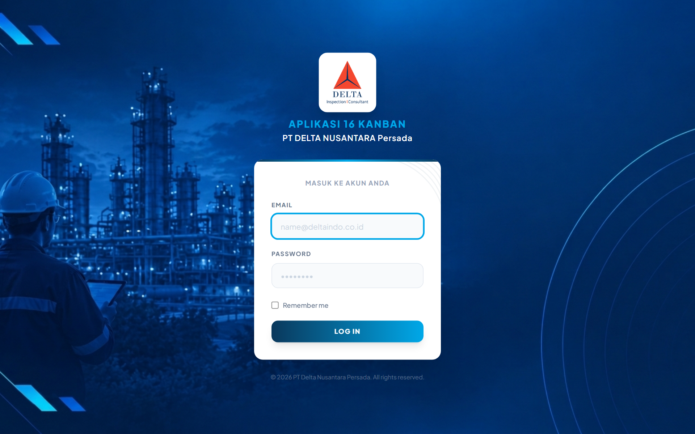
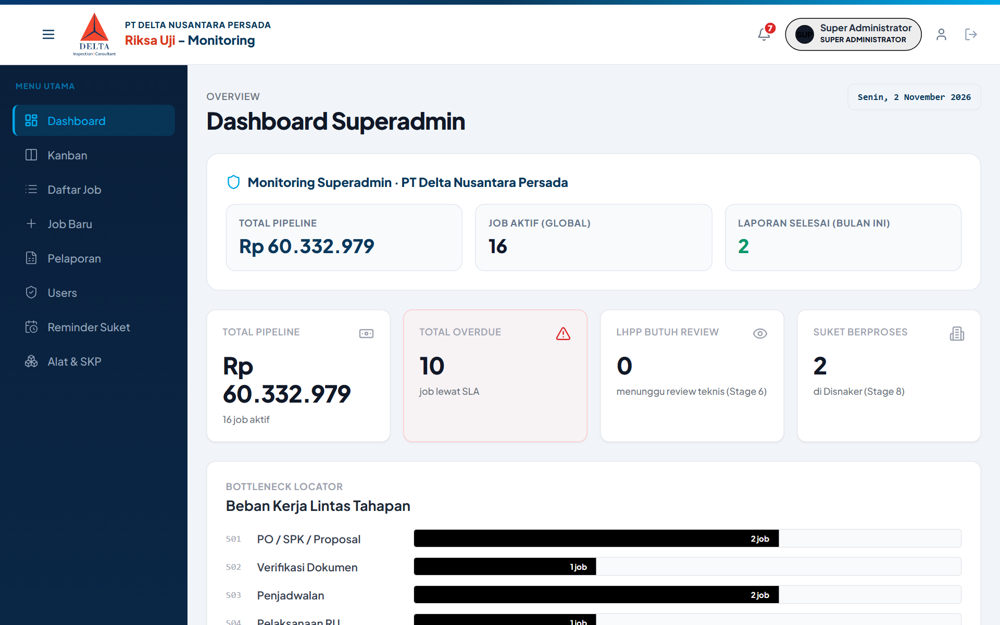
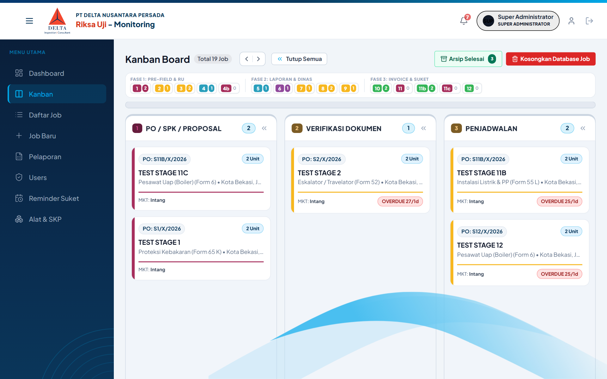
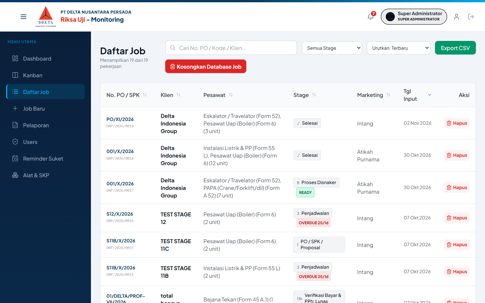
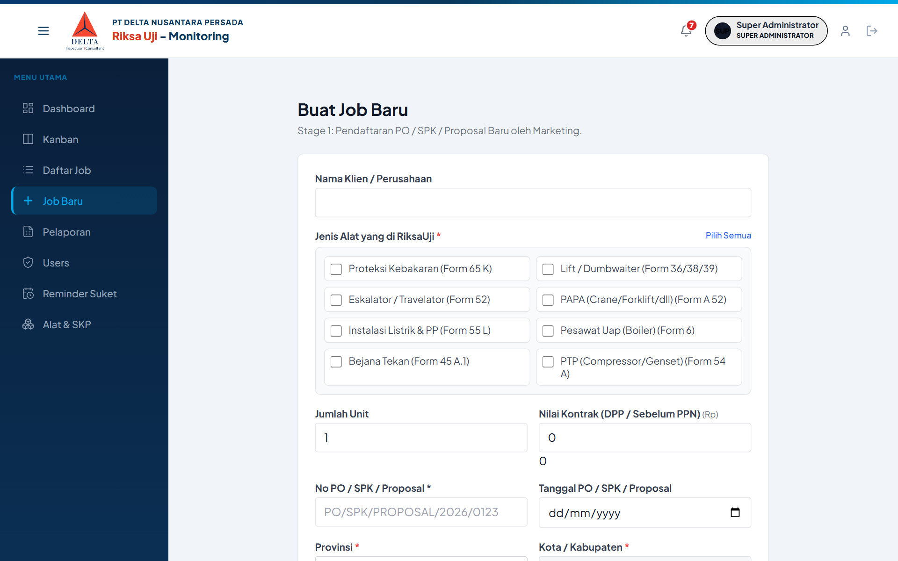
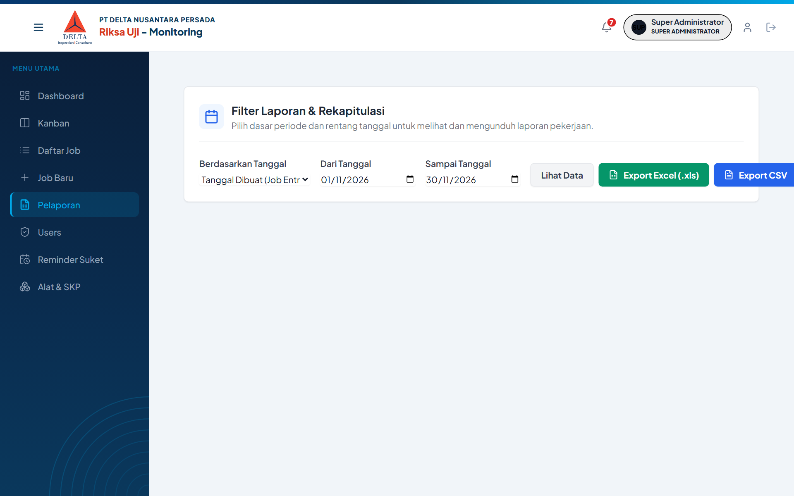
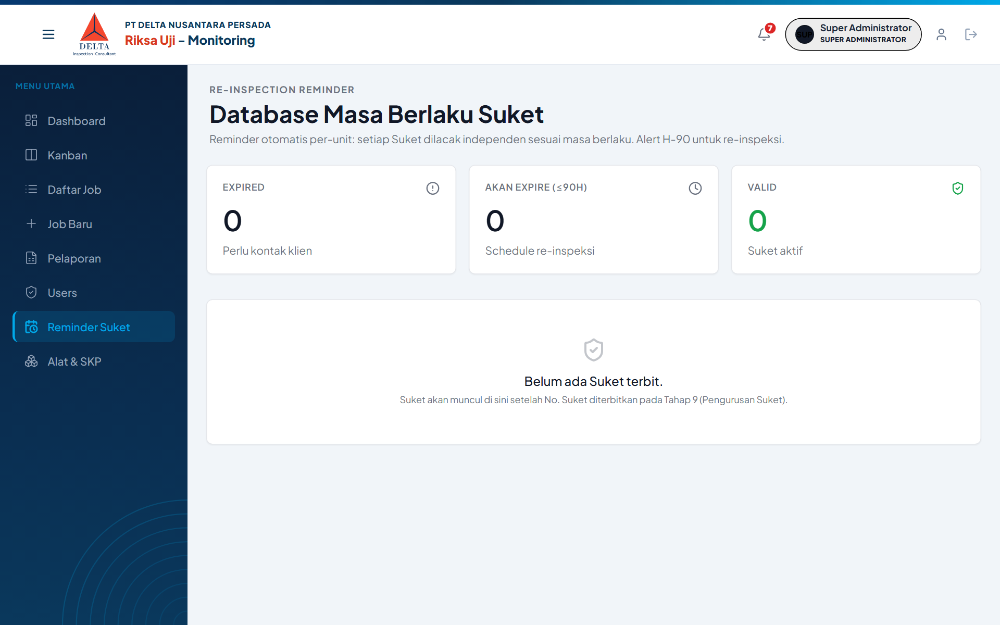
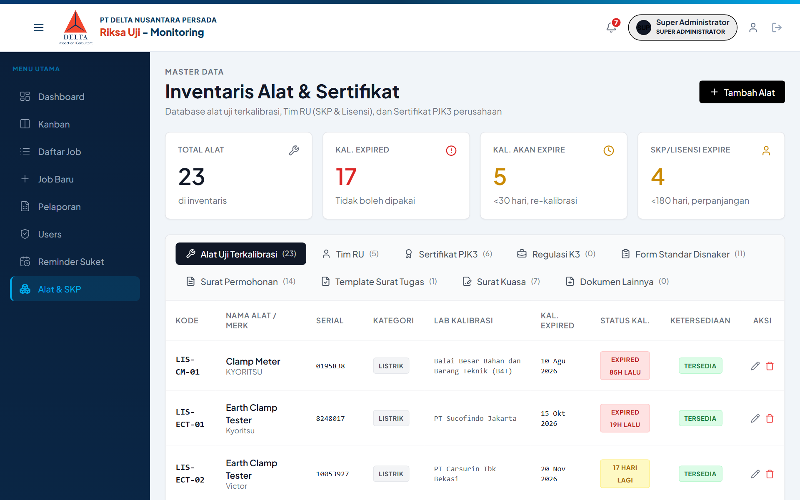
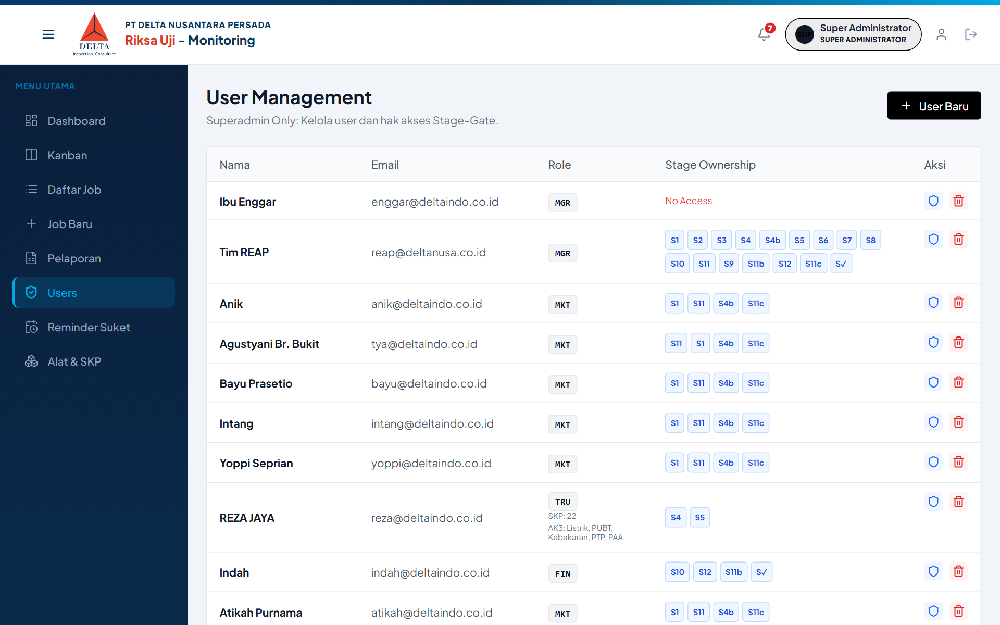

# PANDUAN PENGGUNA RESMI (USER GUIDE MANUAL)
# APLIKASI 16 KANBAN (DNP MONITOR RIKSA UJI)
> **PT DELTA NUSANTARA PERSADA**  
> *Perusahaan Jasa Keselamatan dan Kesehatan Kerja (PJK3)*  
> **Tautan Akses Resmi:** [https://monitor-dnp.deltaindo.co.id/](https://monitor-dnp.deltaindo.co.id/)  
> **Versi Panduan:** 2.4-User Edition | **Klasifikasi:** Petunjuk Operasional Karyawan & Pengguna Sistem

---

## DAFTAR ISI

- [DAFTAR GAMBAR](#daftar-gambar)
- [BAB 1: PENDAHULUAN & PENGENALAN SISTEM](#bab-1-pendahuluan--pengenalan-sistem)
  - [1.1 Mengenal DNP Monitor Riksa Uji](#11-mengenal-dnp-monitor-riksa-uji)
  - [1.2 Alur Kerja Utama Riksa Uji (12 Tahapan)](#12-alur-kerja-utama-riksa-uji-12-tahapan)
  - [1.3 Peran Pengguna & Tanggung Jawab Operasional](#13-peran-pengguna--tanggung-jawab-operasional)
- [BAB 2: CARA MENGAKSES SISTEM & NAVIGASI DASAR](#bab-2-cara-mengakses-sistem--navigasi-dasar)
  - [2.1 Alamat Resmi Akses Sistem](#21-alamat-resmi-akses-sistem)
  - [2.2 Panduan Masuk ke Akun (Login)](#22-panduan-masuk-ke-akun-login)
  - [2.3 Struktur Menu Navigasi Utama](#23-struktur-menu-navigasi-utama)
  - [2.4 Panduan Keluar Akun (Logout)](#24-panduan-keluar-akun-logout)
- [BAB 3: PANDUAN PENGGUNAAN DASHBOARD KPI](#bab-3-panduan-penggunaan-dashboard-kpi)
  - [3.1 Membaca Kartu Ringkasan Kinerja](#31-membaca-kartu-ringkasan-kinerja)
  - [3.2 Memantau Beban Kerja Lintas Tahapan](#32-memantau-beban-kerja-lintas-tahapan)
  - [3.3 Membaca Indikator Keterlambatan Dinas](#33-membaca-indikator-keterlambatan-dinas)
- [BAB 4: PANDUAN PAPAN KERJA VISUAL (KANBAN BOARD)](#bab-4-panduan-papan-kerja-visual-kanban-board)
  - [4.1 Menjelajahi 14 Kolom Tahapan Pekerjaan](#41-menjelajahi-14-kolom-tahapan-pekerjaan)
  - [4.2 Membaca Kartu Pekerjaan & Lencana Peringatan](#42-membaca-kartu-pekerjaan--lencana-peringatan)
  - [4.3 Membuka Panel Rincian Pekerjaan (Job Detail Sheet)](#43-membuka-panel-rincian-pekerjaan-job-detail-sheet)
- [BAB 5: PANDUAN DAFTAR TABEL PEKERJAAN (JOB LIST)](#bab-5-panduan-daftar-tabel-pekerjaan-job-list)
  - [5.1 Menampilkan Seluruh Pekerjaan Aktif](#51-menampilkan-seluruh-pekerjaan-aktif)
  - [5.2 Menggunakan Fitur Pencarian & Filter Cepat](#52-menggunakan-fitur-pencarian--filter-cepat)
- [BAB 6: PANDUAN MEMBUAT PEKERJAAN BARU (+ JOB BARU)](#bab-6-panduan-membuat-pekerjaan-baru--job-baru)
  - [6.1 Langkah Pendaftaran Pekerjaan Baru](#61-langkah-pendaftaran-pekerjaan-baru)
  - [6.2 Memanfaatkan Kalkulator Otomatis PPN 12%](#62-memanfaatkan-kalkulator-otomatis-ppn-12)
  - [6.3 Menentukan Jadwal Multi-Hari & Berkas Wajib PO](#63-menentukan-jadwal-multi-hari--berkas-wajib-po)
  - [6.4 Tabel Petunjuk Pengisian Formulir Job Baru](#64-tabel-petunjuk-pengisian-formulir-job-baru)
- [BAB 7: PANDUAN LANGKAH OPERASIONAL TAHAPAN RIKSA UJI (STAGE 1 – 12)](#bab-7-panduan-langkah-operasional-tahapan-riksa-uji-stage-1--12)
  - [7.1 Memahami Lembar Kerja Terpadu (Job Detail Sheet)](#71-memahami-lembar-kerja-terpadu-job-detail-sheet)
  - [7.2 Stage 1: PO / SPK & Kelengkapan Awal](#72-stage-1-po--spk--kelengkapan-awal)
  - [7.3 Stage 2: Verifikasi Dokumen & Permohonan Bypass](#73-stage-2-verifikasi-dokumen--permohonan-bypass)
  - [7.4 Stage 3: Penjadwalan, Rekomendasi Ahli & Unduh Surat Tugas](#74-stage-3-penjadwalan-rekomendasi-ahli--unduh-surat-tugas)
  - [7.5 Stage 4: Pelaksanaan Lapangan & Unggah Bukti BAP](#75-stage-4-pelaksanaan-lapangan--unggah-bukti-bap)
  - [7.6 Penanganan Khusus Unit Mismatch di Lapangan (Stage 4b)](#76-penanganan-khusus-unit-mismatch-di-lapangan-stage-4b)
  - [7.7 Stage 5: Penyusunan LHPP & Tautan Berkas Multi-Unit](#77-stage-5-penyusunan-lhpp--tautan-berkas-multi-unit)
  - [7.8 Stage 6: Pemeriksaan Teknis oleh Kadiv RU / Manager](#78-stage-6-pemeriksaan-teknis-oleh-kadiv-ru--manager)
  - [7.9 Stage 7 & 8: Penyerahan & Pengawalan Berkas Dinas (SLA EWS 30 Hari)](#79-stage-7--8-penyerahan--pengawalan-berkas-dinas-sla-ews-30-hari)
  - [7.10 Stage 9: Pengesahan & Pencatatan Nomor Suket Resmi](#710-stage-9-pengesahan--pencatatan-nomor-suket-resmi)
  - [7.11 Stage 10: Penerbitan Tagihan Invoice & Faktur Pajak](#711-stage-10-penerbitan-tagihan-invoice--faktur-pajak)
  - [7.12 Stage 11: Penyerahan Fisik Suket ke Perwakilan Klien](#712-stage-11-penyerahan-fisik-suket-ke-perwakilan-klien)
  - [7.13 Stage 11b & 12: Konfirmasi Pelunasan & Penutupan Pekerjaan](#713-stage-11b--12-konfirmasi-pelunasan--penutupan-pekerjaan)
- [BAB 8: PANDUAN PENGGUNAAN MODUL PENDUKUNG & ADMINISTRASI](#bab-8-panduan-penggunaan-modul-pendukung--administrasi)
  - [8.1 Modul Pelaporan & Penarikan Rekap Data](#81-modul-pelaporan--penarikan-rekap-data)
  - [8.2 Modul Pengingat Masa Berlaku (Reminder Suket & SKP)](#82-modul-pengingat-masa-berlaku-reminder-suket--skp)
  - [8.3 Modul Inventaris Alat Uji & Monitoring Kalibrasi](#83-modul-inventaris-alat-uji--monitoring-kalibrasi)
  - [8.4 Modul Pengaturan Pengguna & Matriks Hak Akses](#84-modul-pengaturan-pengguna--matriks-hak-akses)
- [BAB 9: KENDALA OPERASIONAL & TANYA JAWAB UMUM (FAQ)](#bab-9-kendala-operasional--tanya-jawab-umum-faq)
  - [9.1 Tanya Jawab Populer Pengguna](#91-tanya-jawab-populer-pengguna)
  - [9.2 Saluran Bantuan & Dukungan Teknis](#92-saluran-bantuan--dukungan-teknis)

---

## DAFTAR GAMBAR

- **Gambar 1:** Halaman Masuk Akun Resmi DNP Monitor
- **Gambar 2:** Tampilan Dashboard Utama & Indikator Kinerja (KPI)
- **Gambar 3:** Papan Kerja Visual Alur Pekerjaan (Kanban Board 14 Stage)
- **Gambar 4:** Tampilan Tabular Daftar Pekerjaan (Job List)
- **Gambar 5:** Formulir Pendaftaran Pekerjaan Baru (+ Job Baru)
- **Gambar 6:** Tampilan Panel Rincian Pekerjaan (Job Detail Sheet)
- **Gambar 7:** Panel Isian Formulir Stage 1 (PO/SPK & Dokumen Legalitas)
- **Gambar 8:** Panel Formulir Stage 2 (Verifikasi Dokumen & Bypass Manager)
- **Gambar 9:** Panel Formulir Stage 3 (Penjadwalan, Ahli K3 & Alat Uji)
- **Gambar 10:** Panel Formulir Stage 4 (Pelaksanaan Pemeriksaan Lapangan & BAP)
- **Gambar 11:** Panel Formulir Stage 5 (Evaluasi Kelaikan & Berkas LHPP)
- **Gambar 12:** Panel Formulir Stage 6 (Review Teknis Laporan oleh Kadiv RU)
- **Gambar 13:** Panel Formulir Stage 8 (Pengawalan Berkas Dinas Tenaga Kerja)
- **Gambar 14:** Panel Formulir Stage 10 (Penagihan Invoice PDF & Faktur Pajak)
- **Gambar 15:** Halaman Rekapitulasi Data & Ekspor Laporan
- **Gambar 16:** Halaman Pengingat Masa Berlaku Dokumen (Reminder Suket & SKP)
- **Gambar 17:** Halaman Master Inventaris Alat Uji & Sertifikat Kalibrasi
- **Gambar 18:** Halaman Manajemen Pengguna Staf & Pengaturan Otoritas

---

# BAB 1: PENDAHULUAN & PENGENALAN SISTEM

## 1.1 Mengenal DNP Monitor Riksa Uji
Aplikasi DNP Monitor adalah platform kerja digital resmi yang digunakan oleh seluruh divisi di **PT Delta Nusantara Persada**. Sistem ini dirancang untuk mempermudah pemantauan riksa uji keselamatan dan kesehatan kerja (K3), mencatat kelengkapan dokumen pesanan klien industri, mengatur penugasan inspektur berlisensi, mengawal pengesahan berkas di Dinas Tenaga Kerja (Disnaker), hingga penyelesaian tagihan keuangan.

Dengan sistem terintegrasi ini:
- Seluruh tim dapat mengetahui posisi pekerjaan secara langsung tanpa perlu bertanya secara manual.
- Keterlambatan berkas di dinas dapat dideteksi lebih dini melalui sistem peringatan waktu.
- Dokumen legalitas (PO, Surat Tugas, LHPP, Suket, Invoice, Faktur) tersimpan rapi dalam arsip digital perusahaan.

## 1.2 Alur Kerja Utama Riksa Uji (12 Tahapan)
Setiap pekerjaan yang diterima dari klien industri akan mengalir melalui tahapan berurutan berikut:
1. **Stage 1 (PO / SPK):** Marketing mendaftarkan order resmi klien dan mengunggah dokumen PO/SPK.
2. **Stage 2 (Verifikasi Dokumen):** Admin memeriksa kelengkapan syarat administrasi dan legalitas.
3. **Stage 3 (Penjadwalan & Surat Tugas):** Admin menetapkan jadwal, menugaskan inspektur, dan memilih alat uji.
4. **Stage 4 (Pelaksanaan RU):** Inspektur melakukan pengujian fisik mesin di pabrik klien dan mengunggah BAP.
5. **Stage 4b (Aktualisasi Unit):** Tahap penyesuaian nilai kontrak jika jumlah alat di lokasi berbeda dari PO.
6. **Stage 5 (Penyusunan LHPP):** Inspektur merumuskan evaluasi kelaikan teknis per unit alat.
7. **Stage 6 (Review Laporan Teknis):** Kadiv RU/Manager memeriksa draf laporan teknis.
8. **Stage 7 (Submit Disnaker):** Penyerahan bundel fisik permohonan ke loket dinas tenaga kerja.
9. **Stage 8 (Proses Disnaker):** Pemantauan proses pengesahan dinas dengan batas target 30 hari kerja.
10. **Stage 9 (Pengurusan Suket):** Penerimaan dan pencatatan nomor register Suket resmi.
11. **Stage 10 (Penagihan):** Finance menerbitkan tagihan invoice dan faktur pajak ke klien.
12. **Stage 11 (Penyerahan Suket):** Marketing menyerahkan dokumen fisik Suket asli kepada klien.
13. **Stage 11b (Pelunasan Pembayaran):** Konfirmasi mutasi pembayaran jika klien bertransaksi tempo.
14. **Stage 12 (Selesai & Closed):** Penutupan pekerjaan dan pengarsipan permanen.

## 1.3 Peran Pengguna & Tanggung Jawab Operasional
Setiap pengguna memiliki hak akses sesuai dengan fungsi divisinya:
- **Marketing (`MKT`):** Membuat job baru di Stage 1, menyesuaikan kontrak di Stage 4b, dan menyerahkan Suket di Stage 11.
- **Admin Dokumen & RU (`ADM`):** Memverifikasi berkas di Stage 2, menjadwalkan tim di Stage 3, memantau dinas di Stage 8, dan mencatatkan nomor Suket di Stage 9.
- **Tim Ahli / Inspektur (`INS`):** Menjalankan pemeriksaan lapangan di Stage 4 serta menulis laporan evaluasi teknis LHPP di Stage 5.
- **Kadiv RU / Manager (`MGR`):** Menyetujui hasil laporan teknis di Stage 6, memberikan izin bypass dokumen di Stage 2, dan memvalidasi bundel dinas di Stage 7.
- **Finance / Keuangan (`FIN`):** Menerbitkan invoice di Stage 10, mengunggah faktur pajak, mengonfirmasi pelunasan di Stage 11b, dan menutup pekerjaan di Stage 12.
- **Super Administrator (`SUP`):** Memiliki wewenang pembukaan kunci, pengelolaan master alat dan akun staf, serta membuka kembali pekerjaan yang telah ditutup jika terjadi revisi khusus.

---

# BAB 2: CARA MENGAKSES SISTEM & NAVIGASI DASAR

## 2.1 Alamat Resmi Akses Sistem
Aplikasi DNP Monitor berbasis website modern dan dapat dibuka menggunakan peramban (Google Chrome, Microsoft Edge, Mozilla Firefox, atau Safari) di komputer kantor, laptop, tablet, maupun telepon genggam (smartphone).

> **Tautan Akses Resmi:**  
> **[https://monitor-dnp.deltaindo.co.id/](https://monitor-dnp.deltaindo.co.id/)**

Pastikan perangkat Anda terhubung dengan koneksi internet yang stabil saat membuka tautan di atas.

## 2.2 Panduan Masuk ke Akun (Login)
Untuk mulai bekerja dengan aplikasi, lakukan langkah berikut:
1. Buka peramban di komputer Anda, lalu ketik alamat **https://monitor-dnp.deltaindo.co.id/**.
2. Sistem akan menampilkan layar masuk akun resmi PT Delta Nusantara Persada.

<em>Gambar 1: Halaman Masuk Akun Resmi DNP Monitor</em>

3. Masukkan **Alamat Email Resmi Perusahaan** Anda (misal: `nama@deltaindo.co.id`) pada kotak input *EMAIL*.
4. Masukkan **Kata Sandi (Password)** Anda pada kotak input *PASSWORD*.
5. Centang kotak **Remember me** jika Anda menggunakan komputer kerja pribadi agar sesi Anda tidak mudah keluar.
6. Klik tombol biru **LOG IN**.
7. Sistem akan memverifikasi data Anda dan langsung mengarahkan Anda ke halaman Dashboard utama.

## 2.3 Struktur Menu Navigasi Utama
Setelah berhasil masuk, Anda akan melihat susunan antarmuka yang terbagi menjadi dua area utama:
- **Bilah Menu Samping (Sidebar Kiri):** Berwarna biru gelap (*Navy*), memuat menu operasional:
  - **Dashboard:** Ringkasan statistik pekerjaan dan peringatan keterlambatan.
  - **Kanban:** Papan alur kerja visual untuk memantau pergerakan stage pekerjaan.
  - **Daftar Job:** Daftar lengkap pekerjaan dalam format tabel baris.
  - **+ Job Baru:** Tombol cepat bagi Marketing untuk mendaftarkan permohonan baru.
  - **Pelaporan:** Modul pembuatan laporan kerja dan unduh berkas spreadsheet.
  - **Users:** Modul pengelolaan akun karyawan (khusus Superadmin).
  - **Reminder Suket:** Modul pengingat otomatis masa berlaku Suket klien, SKP Ahli K3, dan Kalibrasi Alat.
  - **Alat & SKP:** Manajemen data inventaris instrumen uji lapangan dan legalitas izin.
- **Bilah Atas (Header Bar):**
  - **Ikon Lonceng Notifikasi:** Menampilkan jumlah pemberitahuan pekerjaan baru atau dokumen yang perlu ditinjau.
  - **Lencana Profil Pengguna:** Menampilkan nama lengkap dan jabatan Anda yang sedang aktif.
  - **Tombol Keluar (Logout):** Tombol di pojok kanan atas untuk mengakhiri sesi kerja dengan aman.

## 2.4 Panduan Keluar Akun (Logout)
Demi menjaga keamanan data industri klien, biasakan selalu keluar dari akun Anda jika telah selesai bekerja:
1. Klik ikon **Keluar / Logout** (tanda pintu dengan anak panah) di pojok kanan atas bilah navigasi.
2. Sistem akan mengakhiri sesi Anda dan mengembalikan tampilan ke layar masuk akun.

---

# BAB 3: PANDUAN PENGGUNAAN DASHBOARD KPI

Halaman Dashboard adalah pusat pemantauan kinerja harian yang menyajikan data secara langsung (real-time).

<em>Gambar 2: Tampilan Dashboard Utama & Indikator Kinerja (KPI)</em>

## 3.1 Membaca Kartu Ringkasan Kinerja
Pada bagian atas dashboard, terdapat kartu informasi utama:
- **TOTAL PIPELINE:** Menampilkan total akumulasi nilai pekerjaan yang sedang berjalan di seluruh tahapan.
- **JOB AKTIF (GLOBAL):** Menunjukkan jumlah pekerjaan yang saat ini sedang diproses oleh seluruh divisi.
- **LAPORAN SELESAI (BULAN INI):** Menunjukkan jumlah pekerjaan yang telah tuntas diterbitkan Suket dan diselesaikan pada bulan berjalan.
- **TOTAL OVERDUE:** Menampilkan peringatan jumlah pekerjaan yang telah melewati batas target waktu pengerjaan (SLA) di dinas tenaga kerja.

## 3.2 Memantau Beban Kerja Lintas Tahapan
Bagian *Beban Kerja Lintas Tahapan* menampilkan diagram batang horizontal dari Stage 1 hingga Stage 12:
- Memperlihatkan di tahapan mana pekerjaan sedang terkonsentrasi.
- Jika terdapat batang yang sangat panjang di tahapan tertentu (misal di Stage 5 LHPP), tim manajemen dapat segera menambah dukungan personel di divisi tersebut.

## 3.3 Membaca Indikator Keterlambatan Dinas
Kotak *Total Overdue* berlatar warna merah muda dengan ikon peringatan segitiga. Jika angka di kotak ini lebih dari nol, staf Admin Teknis wajib membuka kartu tersebut untuk memeriksa kendala berkas di dinas tenaga kerja setempat.

---

# BAB 4: PANDUAN PAPAN KERJA VISUAL (KANBAN BOARD)

Papan Kanban adalah sarana visual utama yang memetakan pekerjaan berdasarkan posisinya di alur 14 stage.

<em>Gambar 3: Papan Kerja Visual Alur Pekerjaan (Kanban Board 14 Stage)</em>

## 4.1 Menjelajahi 14 Kolom Tahapan Pekerjaan
Pada papan Kanban, layar terbagi menjadi kolom-kolom berurutan:
- Kolom bergerak dari kiri ke kanan (mulai dari Stage 1 hingga Stage 12).
- Setiap kolom menampilkan judul tahapan dan jumlah kartu pekerjaan yang sedang berada di tahapan tersebut.
- Geser layar ke arah samping kanan (scroll horizontal) untuk melihat tahapan berikutnya.

## 4.2 Membaca Kartu Pekerjaan & Lencana Peringatan
Setiap kartu di papan Kanban mewakili satu berkas pekerjaan klien:
- **Nama Perusahaan Klien:** Ditampilkan dengan huruf tebal di bagian atas kartu.
- **Kode Pekerjaan & Bidang:** Menampilkan kode registrasi (misal: `DNP-2026-0042`) dan kategori alat (misal: Pesawat Uap, Elevator, Listrik).
- **Jumlah Unit:** Informasi berapa unit mesin yang diperiksa.
- **Lencana Peringatan Kendala Dinas (`s8_delay_reason`):** Khusus pada kolom Stage 8 (Proses Disnaker), jika berkas mengalami hambatan, kartu akan menampilkan lencana merah bertuliskan alasan kendala (misal: *Petugas Dinas Luar Kota* atau *Perbaikan Berkas Permohonan*) sehingga semua divisi langsung mengetahui statusnya tanpa perlu saling menelepon.

## 4.3 Membuka Panel Rincian Pekerjaan (Job Detail Sheet)
Untuk melihat dokumen, mengisi formulir pemeriksaan, atau memajukan tahapan:
1. Cukup **klik satu kali pada kartu pekerjaan** yang ingin Anda kerjakan di papan Kanban.
2. Sistem akan membuka lembar kerja terpadu (*Job Detail Sheet*) dari sisi kanan layar.

---

# BAB 5: PANDUAN DAFTAR TABEL PEKERJAAN (JOB LIST)

Bagi pengguna yang lebih nyaman melihat ringkasan pekerjaan dalam jumlah banyak secara terstruktur, menu **Daftar Job** menyediakan tampilan tabel lengkap.

<em>Gambar 4: Tampilan Tabular Daftar Pekerjaan (Job List)</em>

## 5.1 Menampilkan Seluruh Pekerjaan Aktif
Tabel menampilkan kolom-kolom penting:
- Nomor Kode Pekerjaan
- Nama Perusahaan Klien
- Jenis Pesawat / Bidang K3
- Jumlah Unit Alat
- Nama Staf Penanggung Jawab Lapangan
- Posisi Tahapan Terkini
- Status Pembayaran Tagihan

## 5.2 Menggunakan Fitur Pencarian & Filter Cepat
Untuk menemukan pekerjaan tertentu di antara ratusan riwayat:
1. Ketik nama PT klien atau nomor kode job pada kolom pencarian di bagian atas tabel.
2. Gunakan kotak filter untuk menyaring berdasarkan **Kategori Bidang K3** (PUBT, PAA, Elevator, Kelistrikan, Lingkungan Kerja) atau menyaring pekerjaan yang berada pada tahapan tertentu.
3. Klik pada baris pekerjaan untuk membuka rincian dokumen lengkap.

---

# BAB 6: PANDUAN MEMBUAT PEKERJAAN BARU (+ JOB BARU)

Pekerjaan riksa uji baru wajib didaftarkan oleh staf **Marketing** atau **Superadmin**.

<em>Gambar 5: Formulir Pendaftaran Pekerjaan Baru (+ Job Baru)</em>

## 6.1 Langkah Pendaftaran Pekerjaan Baru
1. Klik tombol **`+ Job Baru`** pada menu samping kiri, atau akses alamat **https://monitor-dnp.deltaindo.co.id/jobs/create**.
2. Masukkan **Nama Perusahaan Klien** lengkap beserta bentuk badannya (misal: *PT Indofood Sukses Makmur Tbk*).
3. Masukkan **Alamat Lokasi Pabrik / Gedung** tempat alat uji berada.
4. Pilih **Kota / Kabupaten** lokasi dari menu pilihan dropdown (tersedia seluruh 514 kota di Indonesia).
5. Masukkan **Nama PIC Lapangan** dari pihak klien dan nomor telepon yang dapat dihubungi.
6. Tentukan **Bidang Pesawat K3** dan masukkan **Jumlah Unit Alat** yang dipesan.

## 6.2 Memanfaatkan Kalkulator Otomatis PPN 12%
Sistem DNP Monitor dilengkapi kalkulator pajak interaktif:
1. Masukkan nominal biaya kontrak murni (sebelum pajak) pada kolom **Nilai Kontrak (DPP)**.
2. Kotak kalkulasi otomatis akan langsung menghitung di layar:
   - **DPP:** Nilai dasar sebelum pajak.
   - **PPN 12%:** Nilai pajak resmi tarif 12%.
   - **Total Tagihan Sesudah PPN:** Nominal keseluruhan yang harus dibayar klien.
Dengan kalkulator ini, staf Marketing tidak perlu lagi menghitung manual menggunakan kalkulator terpisah, sehingga mencegah kekeliruan angka penawaran.

## 6.3 Menentukan Jadwal Multi-Hari & Berkas Wajib PO
1. Tentukan rentang tanggal rencana pengujian lapangan menggunakan fitur kalender pemilihan tanggal.
2. **Unggah Dokumen Legalitas Awal:**
   - Siapkan berkas pindaian (scan) Purchase Order (PO), Surat Perintah Kerja (SPK), atau Surat Permohonan Klien.
   - Seret (drag and drop) berkas ke kotak unggah yang tersedia, atau klik untuk memilih file dari komputer.
   - *Catatan Penting:* Minimal salah satu dari dokumen PO/SPK, Surat Permohonan, atau Surat Kuasa **wajib diunggah** agar pekerjaan dapat disetujui untuk berlanjut ke tahap berikutnya.
3. Klik tombol biru **Simpan & Daftarkan Job**. Pekerjaan baru akan otomatis muncul di Stage 1 pada papan Kanban.

## 6.4 Tabel Petunjuk Pengisian Formulir Job Baru
| Nama Isian (Field) | Tipe Isian | Penjelasan & Contoh Pengisian | Wajib / Opsional |
|---|---|---|:---:|
| **Nama Klien** | Teks Bebas | Nama resmi PT atau instansi pemohon (misal: *PT Surya Semesta Mandiri*) | **Wajib** |
| **Alamat Proyek** | Teks Paragraf | Alamat fisik area pabrik tempat mesin dipasang | **Wajib** |
| **Kota / Kabupaten** | Dropdown | Pilih nama kota tempat lokasi inspeksi | **Wajib** |
| **PIC Lapangan** | Teks Bebas | Nama koordinator perwakilan klien di lokasi proyek | **Wajib** |
| **Kontak PIC** | Angka / Teks | Nomor WhatsApp atau telepon kantor PIC klien | **Wajib** |
| **Bidang K3** | Pilihan | Kategori pengujian (misal: *Pesawat Angkat & Angkut*) | **Wajib** |
| **Jumlah Unit** | Angka Bulat | Jumlah unit mesin yang tercantum pada kesepakatan PO | **Wajib** |
| **Nilai Kontrak (DPP)** | Nominal Uang | Masukkan angka rupiah murni tanpa titik (misal: `35000000`) | **Wajib** |
| **Unggahan PO/SPK** | File PDF/Gambar | Scan surat pesanan resmi dari klien | **Wajib (Minimal 1)** |

---

# BAB 7: PANDUAN LANGKAH OPERASIONAL TAHAPAN RIKSA UJI (STAGE 1 – 12)

Setiap tahapan dikerjakan melalui panel geser **Job Detail Sheet** yang muncul saat kartu pekerjaan diklik.

<em>Gambar 6: Tampilan Panel Rincian Pekerjaan (Job Detail Sheet)</em>

## 7.1 Memahami Lembar Kerja Terpadu (Job Detail Sheet)
Pada panel detail pekerjaan:
- Bagian atas memuat tombol-tombol nomor tahapan (S01 hingga S12). Tahapan yang sedang aktif akan menyala dengan warna latar terang.
- Pengguna hanya dapat mengubah isian pada tahapan yang menjadi tanggung jawab divisinya.
- Terdapat tab untuk melihat riwayat aktivitas dokumen dan berkas yang telah diunggah sebelumnya.

---

## 7.2 Stage 1: PO / SPK & Kelengkapan Awal

<em>Gambar 7: Panel Isian Formulir Stage 1 (PO/SPK & Dokumen Legalitas)</em>

- **Pelaksana:** Divisi Marketing (`MKT`).
- **Tugas Utama:** Memastikan data identitas pemesan, nomor kontak, dan berkas pesanan resmi telah tersimpan lengkap.
- **Tindakan:** Periksa kembali kesesuaian nilai kontrak dan dokumen PO. Jika seluruh syarat awal sudah terpenuhi, klik tombol **Lanjutkan ke Stage 2**.

---

## 7.3 Stage 2: Verifikasi Dokumen & Permohonan Bypass

<em>Gambar 8: Panel Formulir Stage 2 (Verifikasi Dokumen & Bypass Manager)</em>

- **Pelaksana:** Admin Dokumen (`ADM`).
- **Tugas Utama:** Memeriksa berkas permohonan, izin pemakaian lama (bila perpanjangan), dan dokumen teknis dari klien.
- **Langkah Pengerjaan:**
  1. Periksa berkas yang tertera pada daftar periksa digital.
  2. Berikan centang status: klik tombol **OK** jika berkas lengkap dan sah, **Tidak** jika berkas belum ada, atau **NA** jika tidak dipersyaratkan untuk jenis alat tersebut.
  3. **Khusus Pesawat Angkat (PAA) dan Lift/Elevator:** Tersedia kotak unggah khusus untuk melampirkan Sertifikat Uji Bahan (*Mill Certificate*) tali baja atau rantai.
  4. **Prosedur Darurat (Bypass Manager):** Apabila jadwal pelaksanaan di lapangan sudah sangat dekat namun klien belum dapat melengkapi dokumen legalitas fisik, Admin dapat mengklik tombol **Request Bypass Manager**. Kadiv RU akan menerima permohonan ini untuk mengesahkan pekerjaan melompat sementara ke Stage 3.

---

## 7.4 Stage 3: Penjadwalan, Rekomendasi Ahli & Unduh Surat Tugas

<em>Gambar 9: Panel Formulir Stage 3 (Penjadwalan, Ahli K3 & Alat Uji)</em>

- **Pelaksana:** Admin Dokumen (`ADM`).
- **Fitur Otomatisasi Penjadwalan:**
  1. Masukkan tanggal pelaksanaan riksa uji di lokasi klien.
  2. **Rekomendasi Cerdas Ahli K3:** Sistem akan membaca bidang pengujian dan menampilkan nama-nama inspektur internal yang memiliki Surat Keputusan Penunjukan (SKP) aktif dari Kemnaker serta tidak memiliki jadwal bentrok pada tanggal yang sama. Pilih inspektur yang bertugas.
  3. **Alokasi Alat Uji:** Pilih instrumen alat uji yang dibutuhkan dari daftar inventaris (pastikan memilih alat dengan status kalibrasi masih berlaku).
  4. **Unduh Otomatis Dokumen Lapangan:**
     - Klik tombol **Download Surat Tugas** untuk mencetak surat penugasan resmi format Word yang sudah terisi nomor surat, nama inspektur, dan nama klien secara otomatis.
     - Klik tombol **Download Form Riksa Uji** untuk mencetak formulir checklist pemeriksaan lapangan.
  5. Klik tombol **Lanjutkan ke Stage 4**.

---

## 7.5 Stage 4: Pelaksanaan Lapangan & Unggah Bukti BAP

<em>Gambar 10: Panel Formulir Stage 4 (Pelaksanaan Pemeriksaan Lapangan & BAP)</em>

- **Pelaksana:** Tim Ahli / Inspektur Lapangan (`INS`).
- **Langkah Pemeriksaan Fisik:**
  1. Inspektur membuka aplikasi melalui smartphone atau tablet saat tiba di pabrik klien.
  2. **Hitung Jumlah Unit Riil:** Masukkan jumlah mesin yang benar-benar siap diuji pada kolom *Jumlah Unit Aktual*.
  3. **Pengisian Checklist Digital:** Periksa kondisi fisik nameplate, struktur rangka, dan fungsi pengaman keselamatan mesin.
  4. **Dokumentasi Visual:** Ambil foto dokumentasi pengujian unit menggunakan kamera HP lalu unggah langsung ke sistem.
  5. **Unggah Berita Acara (BAP):** Setelah pengujian selesai, minta tanda tangan dan cap stempel basah perwakilan klien pada lembar Berita Acara Pemeriksaan (BAP), lalu foto dan unggah ke kotak berkas BAP.
  6. Klik tombol **Lanjutkan ke Stage 5**.

---

## 7.6 Penanganan Khusus Unit Mismatch di Lapangan (Stage 4b)
Jika saat pemeriksaan di lapangan jumlah mesin yang diuji **berbeda dari jumlah pada kontrak PO awal** (misalnya pada kontrak tertulis 5 unit, namun di lokasi pabrik hanya ada 3 unit yang siap diuji):
1. Inspektur memasukkan angka aktual pada kolom *Jumlah Unit Aktual*. Sistem akan otomatis mendeteksi ketidaksesuaian angka.
2. Sistem mengaktifkan tombol kuning **Kembalikan ke Stage 1 / Alihkan ke Stage 4b**.
3. Pekerjaan akan diarahkan kembali ke staf Marketing.
4. Marketing berkoordinasi dengan bagian pengadaan klien untuk merevisi nilai kontrak atau menerbitkan lampiran penyesuaian unit sebelum penulisan laporan teknis dilanjutkan.

---

## 7.7 Stage 5: Penyusunan LHPP & Tautan Berkas Multi-Unit

<em>Gambar 11: Panel Formulir Stage 5 (Evaluasi Kelaikan & Berkas LHPP)</em>

- **Pelaksana:** Tim Ahli / Inspektur (`INS`).
- **Langkah Penyusunan Laporan:**
  1. **Matriks Evaluasi Kelaikan:** Masukkan nomor seri atau identitas tiap unit alat. Tentukan kesimpulan kelaikan teknis: pilih **Laik**, **Laik Bersyarat**, atau **Tidak Laik**.
  2. Tuliskan ringkasan *Temuan Teknis* (kerusakan/kekurangan alat) dan butir *Rekomendasi Perbaikan* yang wajib dipenuhi klien sesuai standar K3.
  3. **Penyimpanan Tautan Berkas Multi-Unit:** Masukkan tautan penyimpanan awan (Google Drive atau penyimpanan korporat) untuk draf laporan per unit alat.
  4. Unggah berkas draf laporan lengkap format PDF. Nama file asli unggahan Anda akan tetap dipertahankan secara utuh oleh sistem.
  5. **Pengiriman Laporan:**
     - Pilih tombol **Kirim Approval ke Manager** untuk penyerahan reguler ke Stage 6.
     - Atau pilih tombol **Bypass Langsung** jika telah mendapatkan persetujuan lisan dari Kadiv RU untuk kebutuhan percepatan berkas dinas.

---

## 7.8 Stage 6: Pemeriksaan Teknis oleh Kadiv RU / Manager

<em>Gambar 12: Panel Formulir Stage 6 (Review Teknis Laporan oleh Kadiv RU)</em>

- **Pelaksana:** Kadiv RU / Manager (`MGR`).
- **Prosedur Pemeriksaan:**
  1. Kadiv RU meneliti kebenaran perhitungan daya, ketebalan bahan, dan rumusan rekomendasi teknis yang disusun oleh inspektur.
  2. Tentukan Keputusan Persetujuan:
     - **Approve (Disetujui):** Laporan valid dan siap diserahkan ke dinas. Pekerjaan maju ke Stage 7.
     - **Approve Bersyarat:** Laporan disetujui dengan catatan revisi minor yang dapat disusulkan.
     - **Reject (Ditolak):** Ditemukan kekeliruan perhitungan teknis yang mendasar. Manager wajib mengisi catatan perbaikan. Sistem akan otomatis **mengembalikan pekerjaan ke Stage 5** agar draf laporan diperbaiki oleh inspektur bersangkutan.

---

## 7.9 Stage 7 & 8: Penyerahan & Pengawalan Berkas Dinas (SLA EWS 30 Hari)

<em>Gambar 13: Panel Formulir Stage 8 (Pengawalan Berkas Dinas Tenaga Kerja)</em>

- **Stage 7 (Submit Disnaker):** Manager memvalidasi kelengkapan fisik bundel permohonan (surat pengantar PJK3, draf LHPP, legalitas izin) dan mencatatkan tanggal penyerahan ke loket Dinas Tenaga Kerja. Pengisian tanggal ini otomatis menyalakan argo waktu 30 hari kerja.
- **Stage 8 (Proses Disnaker):**
  - **Sistem Pengingat 30 Hari (EWS):** Layar memantau sisa hari proses pengesahan dinas. Lencana berwarna hijau jika proses aman, kuning jika mendekati batas, dan merah jika telah melewati 30 hari kerja.
  - **Catatan Koordinasi Rutin:** Admin wajib melakukan koordinasi dengan pengawas dinas minimal 7 hari sekali dan mencatat hasilnya melalui tombol **Tambah Log Follow-Up**.
  - **Tanda Kendala Berkas (`s8_delay_reason`):** Jika berkas tertahan di dinas, pilih opsi status kendala dan tuliskan alasannya agar terpantau pada kartu Kanban board.

---

## 7.10 Stage 9: Pengesahan & Pencatatan Nomor Suket Resmi
- **Pelaksana:** Admin Dokumen (`ADM`).
- **Langkah Kerja:**
  1. Menerima dokumen Surat Keterangan (Suket) K3 fisik asli yang telah ditandatangani dan distempel oleh Kepala Dinas Tenaga Kerja.
  2. Masukkan **Nomor Suket Resmi** per unit alat.
  3. Masukkan **Tanggal Terbit** dan **Masa Berlaku** (standar 12 bulan atau 24 bulan). Sistem otomatis menghitung tanggal kadaluarsa dan menjadwalkan notifikasi peringatan pada **H-90** sebelum habis masa berlakunya.
  4. Unggah scan dokumen Suket asli format PDF, lalu klik **Lanjutkan ke Stage 10**.

---

## 7.11 Stage 10: Penerbitan Tagihan Invoice & Faktur Pajak

<em>Gambar 14: Panel Formulir Stage 10 (Penagihan Invoice PDF & Faktur Pajak)</em>

- **Pelaksana:** Staf Keuangan / Finance (`FIN`).
- **Langkah Penagihan:**
  1. Masukkan Nomor Invoice resmi perusahaan dan nilai tagihan akhir.
  2. Tentukan batas waktu pembayaran melalui pengisian **Terms of Payment (TOP Hari)** (misal: 14 hari atau 30 hari).
  3. **Ketentuan Mutlak Berkas Invoice:** File invoice wajib disimpan dan diunggah dalam format **.PDF** asli. Sistem secara otomatis menolak berkas gambar (.jpg/.png).
  4. **Slot Khusus Faktur Pajak Elektronik:** Masukkan nomor Faktur Pajak DJP dan unggah berkas e-faktur pada slot yang disediakan tanpa menimpa berkas invoice.
  5. **Peringatan Tutup Pajak Tanggal 15:** Layar menampilkan banner peringatan finansial menjelang tanggal 15 setiap bulannya sebagai pengingat batas penutupan masa pelaporan pajak bulanan.
  6. Klik tombol **Lanjutkan ke Stage 11**.

---

## 7.12 Stage 11: Penyerahan Fisik Suket ke Perwakilan Klien
- **Pelaksana:** Divisi Marketing (`MKT`).
- **Langkah Serah Terima:**
  1. Staf Marketing menyerahkan fisik dokumen asli Suket dan buku laporan cetak kepada perwakilan manajemen klien.
  2. Buka lembar kerja Stage 11: masukkan **Tanggal Penyerahan** dan **Nama Penerima Klien**.
  3. Unggah scan lembar tanda terima dokumen yang telah ditandatangani dan dicap stempel oleh pihak klien.
  4. Klik **Lanjutkan**.

---

## 7.13 Stage 11b & 12: Konfirmasi Pelunasan & Penutupan Pekerjaan
- **Stage 11b (Pelunasan Pembayaran):** Jika klien menggunakan skema pembayaran tempo/kredit, Finance memantau rekening koran bank. Setelah pembayaran masuk, Finance mengunggah bukti transfer bank dan mengaktifkan status **Lunas (Paid)**.
- **Stage 12 (Selesai & Closed):**
  - Syarat mutlak menutup pekerjaan: Status pembayaran wajib **Lunas** dan seluruh berkas wajib telah lengkap terunggah.
  - Staf Finance atau Superadmin mengklik tombol **Tutup Job (Closed)**.
  - Berkas pekerjaan dinyatakan selesai secara resmi dan dipindahkan ke dalam arsip digital permanen.

---

# BAB 8: PANDUAN PENGGUNAAN MODUL PENDUKUNG & ADMINISTRASI

## 8.1 Modul Pelaporan & Penarikan Rekap Data
Menu **Pelaporan** (akses: **https://monitor-dnp.deltaindo.co.id/pelaporan**) digunakan untuk menyusun laporan operasional berkala.

<em>Gambar 15: Halaman Rekapitulasi Data & Ekspor Laporan</em>

- **Langkah Penarikan Data:**
  1. Tentukan rentang tanggal pekerjaan (Tanggal Awal dan Tanggal Akhir).
  2. Pilih filter status pekerjaan yang ingin ditarik (Pekerjaan Berjalan, Selesai, atau Seluruhnya).
  3. Klik tombol hijau **Export Excel / Spreadsheet** untuk mengunduh rekapitulasi data lengkap ke komputer Anda.

---

## 8.2 Modul Pengingat Masa Berlaku (Reminder Suket & SKP)
Menu **Reminder Suket** (akses: **https://monitor-dnp.deltaindo.co.id/reminder-suket**) berfungsi sebagai sistem pengawasan otomatis masa kadaluarsa dokumen hukum perusahaan.

<em>Gambar 16: Halaman Pengingat Masa Berlaku Dokumen (Reminder Suket & SKP)</em>

- **Pengingat Suket Klien (H-90):** Menampilkan daftar sertifikat Suket milik klien industri yang masa berlakunya akan habis dalam kurun waktu 90 hari ke depan. Bagian Marketing dapat menggunakan daftar ini untuk menghubungi klien dan menawarkan jadwal resertifikasi berkala.
- **Pengingat SKP Ahli K3 (H-60):** Memantau masa berlaku Surat Keputusan Penunjukan Ahli K3 internal PT Delta Nusantara Persada agar dapat diperpanjang tepat waktu ke Kementerian Ketenagakerjaan.
- **Pengingat Kalibrasi Alat Uji (H-30):** Memantau masa berlaku sertifikat kalibrasi laboratorium KAN untuk seluruh peralatan uji fisik perusahaan.

---

## 8.3 Modul Inventaris Alat Uji & Monitoring Kalibrasi
Menu **Alat & SKP** (akses: **https://monitor-dnp.deltaindo.co.id/inventory**) mengelola seluruh aset instrumen pengujian teknik milik perusahaan.

<em>Gambar 17: Halaman Master Inventaris Alat Uji & Sertifikat Kalibrasi</em>

- **Kelola 23 Master Alat Uji:** Mendata instrumen Earth Tester, Megger Insulation Tester, Thickness Meter Ultrasonic, Sound Level Meter, Lux Meter, Gas Detector, dan alat ukur lainnya.
- **Pembaruan Sertifikat Kalibrasi:** Ketika alat selesai dikalibrasi ulang oleh laboratorium independen terakreditasi KAN, klik tombol **Edit** pada baris alat tersebut, perbarui tanggal kalibrasi terbaru, dan unggah sertifikat kalibrasi PDF baru.

---

## 8.4 Modul Pengaturan Pengguna & Matriks Hak Akses
Menu **Users** (akses: **https://monitor-dnp.deltaindo.co.id/users**) khusus diakses oleh **Super Administrator**.

<em>Gambar 18: Halaman Manajemen Pengguna Staf & Pengaturan Otoritas</em>

- **Pendaftaran Akun Karyawan Baru:** Menambahkan nama staf, alamat email resmi `@deltaindo.co.id`, jabatan, dan nomor WhatsApp dinas untuk pengiriman notifikasi pekerjaan.
- **Matriks Izin Pengerjaan Tahapan:** Mengatur secara spesifik tahapan nomor berapa saja yang dapat dibuka dan disetujui oleh pengguna tersebut guna menjaga ketertiban wewenang antar divisi.

---

# BAB 9: KENDALA OPERASIONAL & TANYA JAWAB UMUM (FAQ)

## 9.1 Tanya Jawab Populer Pengguna

**Q1: Mengapa tombol "Lanjutkan ke Stage Berikutnya" berwarna abu-abu dan tidak dapat diklik?**  
*Jawaban:* Tombol lanjutkan sengaja dikunci oleh sistem untuk mencegah berkas yang belum lengkap berpindah tahapan. Pastikan seluruh kolom isian yang bertanda bintang merah (*Wajib*) telah terisi, dan dokumen wajib pada tahapan tersebut (seperti scan PO di Stage 1, BAP di Stage 4, atau Invoice PDF di Stage 10) sudah terunggah sempurna.

**Q2: Mengapa sistem menolak berkas invoice yang saya unggah di Stage 10?**  
*Jawaban:* Sistem memberlakukan aturan keamanan keuangan yang mewajibkan berkas invoice dalam format **.PDF asli** dengan ukuran berkas di bawah 10 MB. Berkas dalam format foto (.jpg, .jpeg, .png) atau dokumen Word (.docx) secara otomatis ditolak oleh sistem. Simpan atau ekspor ulang dokumen tagihan Anda menjadi format PDF sebelum mengunggah.

**Q3: Bagaimana jika jumlah alat di lokasi pabrik klien berbeda dengan yang tertera pada kontrak PO awal?**  
*Jawaban:* Pada Stage 4, inspektur cukup memasukkan angka fisik yang riil pada kolom *Jumlah Unit Aktual*. Sistem akan menampilkan peringatan dan menyediakan tombol **Kembalikan ke Stage 1 / Stage 4b**. Klik tombol tersebut agar divisi Marketing dapat berkoordinasi dengan pihak pengadaan klien untuk merevisi nilai kontrak secara resmi.

**Q4: Jadwal pengujian di lapangan sudah sangat mendesak, tetapi dokumen izin pemakaian lama dari klien belum ditemukan. Apa solusinya?**  
*Jawaban:* Di Stage 2, staf Admin Teknis dapat menekan tombol **Request Bypass Manager**. Permohonan izin dispensasi akan terkirim ke akun Kadiv RU / Manager. Jika disetujui oleh Manager, pekerjaan diizinkan melangkah ke Stage 3 dengan catatan dokumen wajib disusulkan sebelum berkas diserahkan ke dinas tenaga kerja.

**Q5: Apakah Inspektur Lapangan dapat melihat besaran nilai rupiah kontrak pekerjaan?**  
*Jawaban:* Tidak. Demi menjaga kerahasiaan komersial perusahaan, akun dengan peran Tim Ahli / Inspektur secara otomatis disembunyikan dari informasi nilai rupiah kontrak maupun rincian tagihan di seluruh halaman aplikasi.

**Q6: Bagaimana cara memperbarui data masa berlaku kalibrasi alat uji yang sudah kadaluarsa?**  
*Jawaban:* Buka menu **Alat & SKP** di menu samping, cari instrumen alat yang baru selesai dikalibrasi, lalu klik tombol **Edit**. Masukkan tanggal kalibrasi baru dari sertifikat dan unggah dokumen pindaian sertifikat kalibrasi laboratorium KAN yang baru.

**Q7: Pekerjaan sudah terlanjur ditutup di Stage 12, namun dinas meminta perbaikan data administrasi. Bagaimana cara membukanya kembali?**  
*Jawaban:* Khusus akun dengan peran **Super Administrator**, sistem menyediakan tombol **Re-open Job** untuk membuka kembali pekerjaan yang telah ditutup ke status aktif tanpa menghapus riwayat pemeriksaan sebelumnya.

---

## 9.2 Saluran Bantuan & Dukungan Teknis

Apabila Anda mengalami kendala teknis di luar panduan ini (misal: kendala koneksi server, kesalahan kata sandi, atau gangguan akses menu):
1. **Dukungan Operasional Internal:** Hubungi Admin Teknis atau Kadiv RU PT Delta Nusantara Persada.
2. **Dukungan Administrator Sistem:** Hubungi Super Administrator melalui pesan dinas resmi perusahaan.
3. **Portal Akses Resmi:** Selalu pastikan Anda membuka tautan resmi perusahaan di **[https://monitor-dnp.deltaindo.co.id/](https://monitor-dnp.deltaindo.co.id/)**.

---
*(Dokumen ini merupakan panduan operasional resmi PT Delta Nusantara Persada. Dilarang menggandakan atau menyebarluaskan dokumen ini kepada pihak luar tanpa persetujuan tertulis dari manajemen perusahaan.)*
